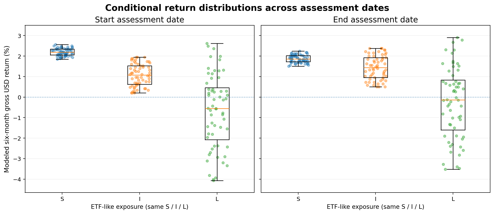
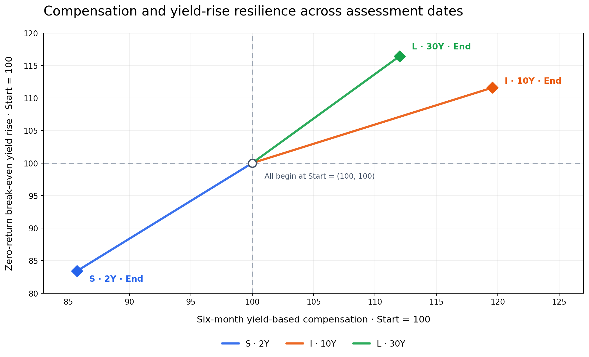

# Bondview-v3 — Fixed-Income Analysis Examples

**Status:** PROVISIONAL companion for design review, based on the GitHub `analysis` branch (2026-10-25). Analyses 1 and 2 have developed examples; Analyses 3–5 remain to be developed. The examples illustrate candidate investor-facing results, not implementation requirements or investment recommendations.

## 1. Purpose and reading conventions

This document demonstrates how fixed-income analysis could help an investor interpret U.S. Treasury conditions and compare eligible bond exposures. Each analysis introduces its own question and any additional inputs. An analysis may use results from an earlier one, but the examples are not a mandatory processing sequence or a single investment case that already covers all five analyses. The methods and eligibility rules are defined in [`bond_etf_decision_architecture.md`](bond_etf_decision_architecture.md); they are not restated here.

**Illustrative data and results.** The examples demonstrate analytical methods, financial interpretations, and potential investment applications. They may use historical observations, constructed datasets, or simplified assumptions, and do not necessarily represent a single historical episode. Numerical results should be understood as illustrations of the analyses rather than independent evidence supporting an investment decision.

**Interpretation and units.** Historical changes describe an interval; scenario assumptions define *conditional* outcomes rather than predicted market paths or probabilities. Treasury-market measures, modeled gross USD cash-bond returns, and realized net KRW ETF returns are distinct quantities. Yield/spread changes and yield-rise cushions are in basis points (bp); modeled returns are percentages of initial value and return differences are percentage points (pp). Individual examples state additional qualifications only where they affect the meaning of a result.

## 2. Analysis examples

### 2.1 Analysis 1 — Treasury Market Conditions and Scenarios (§3.1)

**Investor's question.** Where has interest-rate pressure concentrated across Treasury maturities, what might account for long-yield changes, and what joint yield movements are compatible with a partial market view?

#### A. Treasury curve conditions and movements — where has rate pressure concentrated?

| Treasury measure | 2024-09-16 | 2025-01-13 | Change | Curve configuration | Movement / regime |
|---|---:|---:|---:|---|---|
| 2Y yield | 3.56% | 4.40% | **+84 bp** | — | Yield rose |
| 10Y yield | 3.63% | 4.79% | **+116 bp** | — | Yield rose |
| 30Y yield | 3.94% | 4.97% | **+103 bp** | — | Yield rose |
| **10Y − 2Y spread** | **+7 bp** | **+39 bp** | **+32 bp** | Upward-sloping → upward-sloping | **Bear steepening** |
| **30Y − 10Y spread** | **+31 bp** | **+18 bp** | **−13 bp** | Upward-sloping → upward-sloping | **Bear flattening** |

**What the investor learns.** Treasury yields rose across all three maturities, but the 10Y yield increased the most. The **10Y − 2Y spread** widened as the 10Y yield rose faster than the 2Y yield, producing bear steepening. Meanwhile, the **30Y − 10Y spread** narrowed as the 10Y yield rose faster than the 30Y yield, producing bear flattening. This identifies the 10Y tenor as the point of greatest upward yield pressure among the three observations and motivates further investigation of expected-rate and term-premium changes.

**Observation-date selection.** The starting and ending dates determine the net movement reported in the table and therefore require careful selection. One approach is to examine the 10Y yield history, identify a period with a recognizable upward or downward direction, and select endpoints representing that movement. Here, the dates illustrate a substantial rise in the 10Y yield from its September 2024 low to January 2025. The resulting classifications describe the **net changes between the selected dates**, not every movement along the intervening path. The 10Y direction motivates the date selection; the relative movements of other tenors provide additional curve information.

**Data source.** U.S. Treasury Daily Treasury Par Yield Curve Rates:
- [September 2024](https://home.treasury.gov/resource-center/data-chart-center/interest-rates/TextView?field_tdr_date_value=2024&type=daily_treasury_yield_curve)
- [January 2025](https://home.treasury.gov/resource-center/data-chart-center/interest-rates/TextView?field_tdr_date_value_month=202501&type=daily_treasury_yield_curve)

Spreads are calculated from the corresponding tenor yields at each date. The classifications apply separately to the 2Y–10Y and 10Y–30Y curve segments. Yield movements indicate the direction of rate-price effects, while their magnitudes for ETF exposures depend on duration and other characteristics examined in Analysis 2.

#### B. Long-yield decomposition — what explains changes in the 10Y yield?

| 10Y model component | 2025-01-10 | 2025-06-10 | Change |
|---|---:|---:|---:|
| Expected average future short rates | 2.95% | 3.10% | +15 bp |
| Term premium | 1.05% | 1.50% | **+45 bp** |
| **Total: model-fitted zero-coupon yield** | **4.00%** | **4.60%** | **+60 bp** |

**What the investor learns.** The model-fitted 10Y yield increased by 60 bp, with 45 bp (75%) attributable to the term premium and 15 bp (25%) to expected future short rates. The larger term-premium contribution indicates that higher compensation for long-term interest-rate risk, rather than revisions to the expected short-rate path, dominated the modeled yield increase.

The two components capture distinct economic dimensions:

| Component | Core interpretation | Main candidate drivers |
|---|---|---|
| **Expected future short rates** | Expected level and path of future short-term interest rates | Monetary-policy outlook, inflation and growth expectations |
| **Term premium** | Required compensation for bearing long-term interest-rate risk | Macroeconomic uncertainty, Treasury duration supply–demand, hedging value |

For example, if investors revise their expectations toward more Fed tightening while viewing the policy path as predictable and credible, the expected short-rate component may increase while the term premium remains relatively stable. If uncertainty about future inflation or interest rates also increases, the term premium may rise. However, term premium is not simply a measure of volatility: it also depends on investors' required risk compensation and the hedging value of long-term Treasuries.

The expected-rate component reflects the model-implied **average short-term rate over the next ten years**, not expectations about the Fed's next decision. Its increase represents an upward revision to that expected average, not necessarily an expectation of imminent rate hikes.

The table uses illustrative component estimates rather than actual ACM, CR or KW model outputs. Each component is estimated at the two observation dates, and its change is calculated from those estimates.

#### C. Conditional joint yield movements — scenario inputs for Analysis 2

Historical-style conditioning selects complete 2Y/10Y/30Y yield-change vectors from the constructed market series under an investor's partial interest-rate view. In this example, the investor expects the 10Y Treasury yield to rise by 25–50 bp over six months. For each six-calendar-month observation pair, the 10Y change is checked against this condition; when it qualifies, the changes at the other tenors from **the same interval** are retained with it. The dataset supplies **28 qualifying joint scenarios**.

| Treasury yield change | Minimum | Median | Maximum |
|---|---:|---:|---:|
| Δ2Y | −54.4 bp | −50.3 bp | −45.2 bp |
| Δ10Y | +25.2 bp | +38.6 bp | +49.2 bp |
| Δ30Y | +19.5 bp | +23.7 bp | +29.2 bp |

The table summarizes each tenor separately; its median values do not constitute a single jointly observed scenario.

**Use in Analysis 2.** All 28 complete joint scenarios are applied consistently to the short-, intermediate- and long-duration exposures for matched holding-period return comparisons. These substantially overlapping windows constitute a limited constructed sample, not a forecast distribution or estimated future probabilities. The underlying vectors and further selection details are provided in Analysis 2.

### 2.2 Analysis 2 — Holding-Period Return (§3.2)

**Investor's question.** Under a selected set of joint Treasury yield scenarios, how do the modeled six-month return distributions of short-, intermediate- and long-duration exposures compare? How does their relative attractiveness change between assessment dates?

**Additional inputs.** This example compares three constructed cash-Treasury ETF-like exposures—short (S), intermediate (I) and long (L)—under 60 illustrative six-month joint yield-change scenarios. The investor-selected condition is a **+5 to +30 bp 10Y yield change**. The same scenario vectors are applied to the exposures at **Start** and **End** assessment dates; those labels refer to exposure snapshots, not the endpoints of a realized six-month return.

#### A. User-facing result — conditional return distributions

**What the investor learns.** At Start, S outperforms I in **all 60 paired scenarios**, with a median of +2.19% versus +1.07% for I. At End, the distributions are closer: S's median is +1.86% versus +1.44% for I, and I outperforms S in **15 of the 60** matched scenarios. The conclusion has shifted from a consistent S advantage over I within this set to a less decisive preference. L exhibits much wider dispersion and substantial negative-return outcomes at both dates.

| Exposure | Start median (middle 50%) | End median (middle 50%) |
|---|---:|---:|
| **S — Short** | +2.19% (+2.05% to +2.34%) | +1.86% (+1.72% to +2.02%) |
| **I — Intermediate** | +1.07% (+0.62% to +1.53%) | +1.44% (+0.95% to +1.93%) |
| **L — Long** | −0.56% (−2.07% to +0.46%) | −0.14% (−1.60% to +0.84%) |

Each dot represents one complete joint yield-change scenario evaluated for one exposure; boxes show the interquartile ranges and medians. The spread and overlap of each return distribution help show dispersion and how clearly exposures can be distinguished. **Relative preference is assessed using returns paired by scenario**, not distribution overlap alone: S outperforms I in 60/60 scenarios at Start and 45/60 at End. These counts describe the constructed set, not future probabilities.

#### B. Supporting result — compensation and yield-rise resilience

| Exposure | Start compensation | End compensation | Start break-even yield rise | End break-even yield rise |
|---|---:|---:|---:|---:|
| **S — Short** | +2.28% | +1.95% | +126.4 bp | +105.4 bp |
| **I — Intermediate** | +2.30% | +2.75% | +32.9 bp | +36.7 bp |
| **L — Long** | +2.50% | +2.80% | +15.8 bp | +18.4 bp |

**What the investor learns.** Each exposure begins at (100, 100), indexing its own Start compensation and break-even yield rise separately. The trajectories show **within-exposure changes**, not absolute cross-exposure rankings. S's modeled yield-based compensation and zero-return break-even cushion decrease between Start and End, while I's increase. That helps explain I's improved position in the return distributions. L also gains compensation, but its much greater duration leaves it more sensitive to adverse yield moves. Break-even levels are **within-exposure** zero-return conditions, not yield thresholds at which two exposures have equal returns; their absolute cross-tenor differences are strongly influenced by duration.

#### Inputs, calculations and reproduction

**Exposure profiles.** The two sets of constructed cash-Treasury exposure characteristics are applied separately to the same joint yield-change scenarios:

| Exposure | Start YTM / duration | End YTM / duration | Matched rate factor |
|---|---:|---:|---|
| **S — Short** | 4.55% / 1.80 | 3.90% / 1.85 | 2Y Treasury |
| **I — Intermediate** | 4.60% / 7.00 | 5.50% / 7.50 | 10Y Treasury |
| **L — Long** | 5.00% / 15.80 | 5.60% / 15.20 | 30Y Treasury |

**Scenario basis.** The 60 constructed joint vectors each contain matched 2Y, 10Y and 30Y yield changes, with 10Y changes between **+5 and +30 bp**. Other-tenor changes vary across the scenarios. The complete vectors and corresponding modeled exposure returns are provided in the [illustrative scenario data](assets/analysis2_illustrative_joint_scenarios.csv). Analysis 1C illustrates the *procedure* for obtaining conditional joint movements; the numerical scenarios here are separate illustrative inputs, not its 28 selected observations. The constructed variations are not calibrated historical frequencies or estimates of a future distribution.

**Return calculation.** For each exposure/profile and each matched scenario, modeled six-month return is approximated by `portfolio YTM × 0.5 − duration × matched tenor yield change (decimal)`. This first-order expression combines yield-based compensation with the local duration price effect, without added convexity, roll-down or portfolio-rebalancing effects. The results are **modeled gross USD cash-bond exposure returns**, not actual ETF returns or realized returns between Start and End. Applying common shocks to both dated profiles isolates the effect of their different YTM/duration assumptions.

**Compensation and break-even calculation.** Six-month compensation is `portfolio YTM × 0.5`. The first-order zero-return break-even yield rise (bp) is `10,000 × compensation / duration` for the exposure's matched yield. The supporting plot indexes both quantities separately to 100 at Start for each exposure and connects Start with End; the table retains absolute values. All plots, medians, interquartile ranges and scenario-paired comparisons use the same constructed profile inputs and complete yield-change vectors.

### 2.3 Analyses awaiting examples

- **Analysis 3 — Risk and Stress (§3.3):** assess adverse sensitivity and downside drivers, reusing the relevant return scenarios when helpful.
- **Analysis 4 — Credit Spread (§3.4):** introduce a credit-exposed case and examine rate-versus-spread effects.
- **Analysis 5 — Currency and Hedging (§3.5):** examine how currency and hedging terms change the outcome for a KRW investor.

Each future example should begin with its own investment question and necessary assumptions. It may extend an earlier example when that relationship adds insight; it need not inherit the current Treasury-only case.
