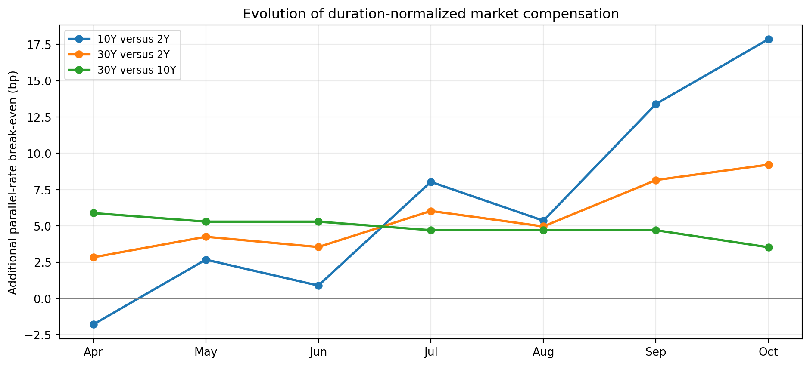
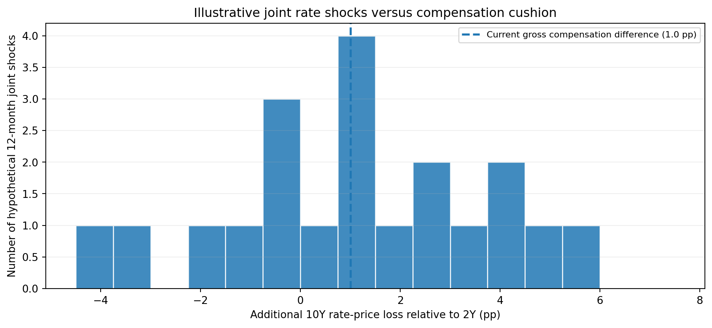
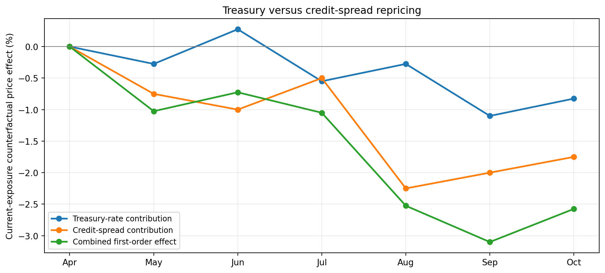

# Bondview-v3 — Korean-Listed U.S. Bond ETF Decision Examples and Validation

**Status:** **PROVISIONAL companion examples — 2026-10-20.** Prepared against the revised `bond_etf_decision_architecture.md` dated 2026-10-20; not a live market study, backtest, accepted investment policy, development roadmap, or authorization for implementation.

**Companion architecture:** [`bond_etf_decision_architecture.md`](bond_etf_decision_architecture.md). If a proposed example is inconsistent with an accepted architecture contract, resolve the conflict before using that example as an implementation acceptance test. Earlier Bondview repositories are not design authorities.

> **All yields, exposure values, credit spreads, FX paths, break-even figures, investor policies and results in this document are constructed examples.** ETF tickers mentioned in the legacy validation section identify historically researched product categories only; they are **not** verified current issuer exposures or recommendations. No actual market data, current ETF sheets, or price histories were used to produce the figures.

## 1. Purpose and interpretation

The examples serve three purposes:

1. **Economic usefulness:** Demonstrate whether conventional fixed-income calculations reveal meaningful changes in investment opportunities between Treasury maturity segments and credit markets.
2. **ETF application:** Show how the same models use published ETF exposure characteristics and produce supported numerical outcomes, qualifications, or clearly unresolved preferences.
3. **Verification:** Preserve reference arithmetic, model-applicability rules, missing-data behavior, and separate product/FX/return diagnostics from the predecessor examples document.

The same **financial definitions and functions** should support an individual ETF, a full historical interval, and a chosen ETF universe. Those are different views and valid relative calculations, not three attractiveness engines. A market-reference illustration may be economically useful before any ETF is selected, but ETF-specific numerical sensitivities require compatible issuer disclosures.

### 1.1 Terminology and unit conventions

- Treasury constant-maturity yields (`2Y`, `5Y`, `10Y`, `30Y`) are **market references**, not coupon-bond or ETF yields to maturity. ETF benchmark tenor **does not determine duration**.
- All yield changes in price-sensitivity formulas are **decimal** (50 bp = `0.005`). `1 bp = 0.01 percentage point = 0.0001 decimal`.
- A *market-reference break-even* substitutes documented or explicitly assumed benchmark durations and market yield differences for a compatible compensation calculation. It **does not** equal actual ETF gross carry or net KRW expected return.
- **Current-exposure counterfactual**: the specified duration and/or spread duration is applied to historical-sized market changes. It is neither realized ETF historical P&L nor a future return prediction.
- **Scenario**: a declared hypothetical yield/spread change, not a probability or price forecast. A conditional preference can be valid without establishing that buying now beats waiting.
- **Unavailable**, **not applicable (N/A)**, **unsupported** and **proxy** have different meanings and must never silently be converted to zeros.
- An issuer's distribution yield is **not** automatically economic carry. No historical issuer yield is manufactured from today's ETF facts.
- Figures are economic visual examples, **not a requirement to implement a particular chart type**. Plot only an analytically meaningful time series; do not multiply graphs that repeat the same source information.

### 1.2 What the example set does and does not establish

The primary investment questions are: (i) how has the compensation for extending Treasury maturity changed relative to associated rate risk? (ii) how large is that compensation relative to historically observed yield-change uncertainty? (iii) does corporate-bond repricing reflect Treasury movements or a credit-specific spread change, and what does that imply under a declared credit scenario? The answers can be complementary, adverse, or mixed. They are not votes for an integrated numerical attractiveness score.

Correct arithmetic does **not** validate a general purchase ranking. The source data and compatibility requirements matter as much as the formula. The purpose of the first research implementation is to challenge these assumptions on actual available market and issuer data—not to tune outcomes until a chart appears persuasive.

---

## 2. Treasury maturity opportunity: break-even compensation across six months

**Economic question:** Has the extra *market yield compensation* for extending exposure from 2Y to 10Y, from 2Y to 30Y, or from 10Y to 30Y improved relative to **additional duration**? In particular, does rising compensation on the long end justify rushing to replace a 10Y exposure with a 30Y exposure?

### 2.1 Constructed Treasury observations and reference exposures

**All month-by-month data below are invented.** They are not actual observations for April–October 2026. Their purpose is to illustrate a **full historical interval**, not just two endpoints.

| Synthetic month | Treasury 2Y | Treasury 10Y | Treasury 30Y |
|---|---:|---:|---:|
| Apr | 4.60% | 4.50% | 5.00% |
| May | 4.55% | 4.70% | 5.15% |
| Jun | 4.45% | 4.50% | 4.95% |
| Jul | 4.35% | 4.80% | 5.20% |
| Aug | 4.30% | 4.60% | 5.00% |
| Sep | 4.20% | 4.95% | 5.35% |
| Oct | 4.10% | 5.10% | 5.40% |

To illustrate the relationship, **assume**, without identifying these with any actual ETF, the following fixed representative durations: 2Y-oriented `D=1.9`, 10Y-oriented `D=7.5`, 30Y-oriented `D=16.0`. These are chosen benchmark-example exposures, **not durations inferred from CMT tenor** and not historically observed ETF portfolio profiles.

Assume that each date's *market-reference yield* can be treated as a **one-year gross compensation proxy** for the illustrative exposure and that both compared yields subsequently experience **the same parallel shift**. This is a strong simplification: it ignores realized ETF carry, convexity, roll-down, hedging, financing and the possibility of nonparallel yield moves.

The first-order conditional advantage of longer exposure `L` over shorter exposure `S` is:

`relative_result_proxy ≈ (c_L - c_S) - (D_L - D_S) * delta_y_parallel`

with all `c` and `delta_y` in decimal units. Setting the difference to zero gives:

`break_even_common_rise_bp = 10,000 * (c_L - c_S) / (D_L - D_S)`, for `D_L > D_S`.

### 2.2 Visualization: historical evolution of duration-adjusted compensation

| Pair | Apr break-even | Oct break-even | Interpretation within assumptions |
|---|---:|---:|---|
| 10Y vs 2Y | −1.79 bp | +17.86 bp | Strong improvement in the longer exposure's relative gross compensation cushion |
| 30Y vs 2Y | +2.84 bp | +9.22 bp | Improvement, but less than 10Y vs 2Y on this measure |
| 30Y vs 10Y | +5.88 bp | +3.53 bp | **Deterioration** in extra compensation per additional duration beyond 10Y |

**Economically meaningful conclusion:** It would be premature to decide to switch from 10Y to 30Y merely because the 30Y yield increased. The incremental compensation cushion for 30Y over 10Y **fell** in this constructed history, even though both tenors became better compensated relative to 2Y. That conclusion is specific to the stated market-yield proxy and parallel-shock assumptions—not a claim that 30Y's future realized return will be lower.

**Not a new independent signal:** The duration-normalized break-even is a transformation of the Treasury yield spread and the assumed durations. Its advantage is an economically interpretable unit (bp of additional common yield increase); it must not be treated as separate statistical confirmation of the source yield-spread movement.

**Validation:** For October, `(5.10−4.10) * 100 / (7.5−1.9) = 17.857... bp`; `(5.40−4.10)*100/(16−1.9) = 9.219... bp`; `(5.40−5.10)*100/(16−7.5) = 3.529... bp`, where yields and their differences are expressed in **percentage-point** units in these three arithmetic shortcuts. The general formula above instead uses **decimal** yields and the `10,000` factor.

**Real ETF application:** Replace benchmark-example durations with comparable **dated, issuer-published ETF durations**; inspect each issuer yield's definition and hedge treatment. Do **not** label the market-yield proxy as the ETF's verified holding-period carry or an actual return break-even if those inputs are unavailable.

**Reproducible source:** [`assets/hypothetical_monthly_market_inputs.csv`](assets/hypothetical_monthly_market_inputs.csv).

---

## 3. Context for the break-even cushion: historically observed rate-risk variation

**Economic question:** Even if today's compensation cushion is larger than six months ago, is it large or small relative to plausible *relative* adverse movements of the 2Y and 10Y curve segments? Does a parallel-shock assumption hide material joint curve risk?

This asks a different question from Section 2. It introduces **joint yield-change variability** rather than merely replotting the current yield spread.

### 3.1 Two-factor relative rate-risk expression

For 2Y-oriented `S` and 10Y-oriented `L`, the first-order relative rate-price effect is:

`relative_rate_price_effect ≈ -D_L * delta_y_10 + D_S * delta_y_2`.

Equivalently, define the **additional relative rate loss** `X = D_L * delta_y_10 - D_S * delta_y_2`. With decimal yields, `X` is a decimal price-loss difference; multiply by 100 to display **percentage points**. Then an illustrative compensation advantage `c_L−c_S` withstands the joint yield move **if** `X < c_L−c_S`, under the simplified gross comparison.

For October's market-yield proxy, the initial one-year compensation difference is `5.10−4.10 = +1.00 percentage point`. The distribution plotted below is constructed from **20 invented paired 12-month changes** in 2Y and 10Y yields. It does **not** come from the seven-month series in Section 2; it is a separate toy reference dataset designed solely to demonstrate the additional analysis. All change-pair observations are synthetic, not a market frequency estimate.

### 3.2 Visualization: compensation versus joint rate-move history

In this toy sample, **10 of 20** paired rate scenarios produce an additional 10Y rate-price loss larger than the assumed `+1.00 pp` gross compensation advantage. This is not a forecast or a claim of 50% future underperformance: the sample is fabricated, small, and not calibrated to any actual interest-rate process.

**New economic information:** The *shape and magnitude of historical joint 2Y/10Y yield changes* matter. Even a favorable 17.86 bp **common-parallel** break-even can coexist with substantial nonparallel relative risk. The analysis adds a genuinely different historical data dimension beyond market-yield spreads.

**For genuine Bondview work:** Use a documented reference window and **horizon-matched historical yield-change pairs** (e.g., rolling 12-month 2Y/10Y changes if the compensation represents a 12-month horizon); retain observed joint moves rather than reducing them to a common shock. Report horizon, sample size, data overlap and limitations; historical distributions are context, not probability estimates for the next year. If true comparable holding-period compensation is unavailable, this remains a **market-reference risk/compensation illustration**.

**Reproducible source:** [`assets/hypothetical_12m_joint_rate_shock_cases.csv`](assets/hypothetical_12m_joint_rate_shock_cases.csv).

---

## 4. Corporate-bond market: Treasury-rate changes versus credit repricing

**Economic question:** Are changes in corporate-bond conditions mainly attributable to changing Treasury rates or to **additional credit spread**? If Treasury yields stabilize or fall while credit spreads widen, what can we conclude about corporate bonds?

### 4.1 Constructed market and reference exposure

Reuse Section 2's imaginary April–October interval and add a hypothetical 5Y Treasury series and investment-grade (IG) index OAS series:

| Synthetic month | Treasury 5Y | IG OAS |
|---|---:|---:|
| Apr | 4.55% | 85 bp |
| May | 4.60% | 100 bp |
| Jun | 4.50% | 105 bp |
| Jul | 4.65% | 95 bp |
| Aug | 4.60% | 130 bp |
| Sep | 4.75% | 125 bp |
| Oct | 4.70% | 120 bp |

For a **defined hypothetical** cash corporate exposure, let `D_rates=5.5` and `D_spread=5.0` (not an actual ETF disclosure).

`credit_price_effect ≈ -D_rates * delta_y_5Y - D_spread * delta_OAS`.

This describes rate and credit sensitivity, not corporate ETF historical return. It excludes coupons, default losses, migration, liquidity, convexity and active portfolio changes.

### 4.2 Visualization: distinct sources of the market shock

| Contribution, April–October | Calculation | Price sensitivity |
|---|---|---:|
| Treasury rates | `−5.5 × 0.0015` | −0.825% |
| Credit spread | `−5.0 × 0.0035` | −1.750% |
| Combined | Sum, first order | **−2.575%** |

**Useful conclusion:** The constructed deterioration is more strongly linked to **credit-spread repricing** than to Treasury-rate repricing. If Treasury yields had been stable or falling while OAS widened, the same method would isolate credit-specific adverse repricing even more clearly.

**Important boundary:** OAS widening may reflect changing expected defaults, liquidity, risk appetite, or required risk premium; it does **not** by itself prove fundamental corporate distress. Conversely, a *negative Treasury-rate contribution* merely reflects a Treasury yield rise, not a unique credit-market problem. The stronger credit warning comes from adverse **spread changes relative to Treasuries**.

### 4.3 Additional gross credit compensation: separate question

With OAS rising from 85 to 120 bp and **assuming** one-year incremental gross compensation equal to OAS, the illustrative spread-widening break-even is:

`gross_spread_cushion_bp = OAS_bp / D_spread`.

It changes from `85 / 5 = 17 bp` to `120 / 5 = 24 bp`. This means increased **gross spread compensation under this assumption**, not proof of sufficient **net** compensation. No expected default loss was subtracted; the example does not recommend purchasing the corporate ETF. The spread cushion is another interpretation of the **same OAS series**, not independent evidence that the credit market is safer.

**ETF application:** Verify the product's investment-grade/high-yield segment, maturity mix, spread duration if available, and the market OAS proxy's coverage. A broad HY OAS must not be silently used as an exact effective spread for a different credit profile.

---

## 5. Applying common analysis to an illustrative ETF universe

**Economic question:** When these bond-market relationships are relevant to actual products, what can a comparable ETF table establish—and where must it stop?

The table below consists of **invented products and hypothetical exposure values**, not live products. It provides a structural illustration only; published ETF data would have to replace every portfolio characteristic. Assume all four cash-bond exposures are being discussed on an **underlying USD-bond basis**, not comparable after-hedge KRW returns.

| Product | Economic reference | Rate duration | Spread duration | Assumed issuer-style YTM | Relevant corporate OAS |
|---|---|---:|---:|---:|---:|
| ETF A | 2Y Treasury | 1.9 | N/A | 4.20% | N/A |
| ETF B | 10Y Treasury | 7.5 | N/A | 5.00% | N/A |
| ETF C | 30Y Treasury | 16.0 | N/A | 5.30% | N/A |
| ETF D | 5Y-matched IG credit | 5.5 | 5.0 | 5.80% | 120 bp (market reference) |

At a **common hypothetical +50 bp Treasury rate shock** and a separate **+100 bp credit-spread shock**, applying Section 6's formulas yields:

| ETF | Rate-only +50 bp shock | Additional +100 bp credit OAS shock | Combined price-only shock |
|---|---:|---:|---:|
| A | −0.95% | N/A | −0.95% |
| B | −3.75% | N/A | −3.75% |
| C | −8.00% | N/A | −8.00% |
| D | −2.75% | −5.00% | −7.75% |

The additional spread shock is assumed **only for the corporate product**, not silently for Treasury ETFs. Combined shocks are **price sensitivities**, not the complete one-year total returns of the respective funds.

**What is established:** A has the smallest modeled rate sensitivity, C the largest, and D introduces a distinct credit risk. All comparisons use the same scenario convention where applicable. **What is not established:** A universal attractiveness ranking, comparable net KRW compensation, or an assertion that A will outperform C. The hypothetical issuer-style YTMs are **not** automatically one-year carry and must not simply be added to the price shocks.

**Important market-versus-ETF distinction:** Section 2's `+17.86 bp` uses **market** 10Y/2Y yield proxies and benchmark-style durations, while the product table lists *different* hypothetical issuer-style YTM values. A true product-level break-even requires **compatible holding-period compensation**, including currency and structural assumptions where relevant. Do not transplant the market-reference break-even into an ETF decision as if the two yield definitions were identical.

**Applicability logic:** A verified pure Treasury ETF has credit OAS `not_applicable`; a corporate ETF without disclosed applicable spread duration may have credit-spread sensitivity `unavailable` or an expressly labeled proxy; a futures ETF with cash-bond carry formula is `unsupported`. All eligible ETFs may appear in the universe, but some analyses must remain partial or conditional.

---

## 6. Existing policy-conditioned purchase cases — retained as synthetic controls

The earlier examples A, B and C verify an **illustrative investor-policy response**, not the existence of an accepted universal purchase rule. This section preserves their arithmetic and interpretation without making the 12-month risk budget the center of Bondview's design.

### 6.1 Legacy Example A — long-duration ETF, modest compensation

**Historically referenced product category:** an issuer-identified hedged long Treasury ETF (formerly illustrated by ticker `453850`; current details must be rechecked). **All following values hypothetical.** Assume current 30Y market yield `4.80%`, 6M/1M yield changes `+70/+20 bp`, portfolio-duration proxy `17.0`, comparable **assumed** 12-month KRW-hedged net carry `4.00%`, assumed 12-month KRW cash return `3.80%`, adverse shock `+100 bp`, investor stress-loss budget `10.00%`.

`rate_price_effect = -17.0%`; `illustrative_net_carry_plus_rate_stress = 4.00% - 17.00% = -13.00%`. If the policy rejects modeled stress losses exceeding 10%, the result is **defer under this specific policy**, not an unconditional sale recommendation or a prediction that rates will continue rising. Convexity is omitted and should be flagged. The assumed 4% net carry is **not inferred from the issuer distribution yield**.

### 6.2 Legacy Example B — same category, changed compensation

Separate hypothetical snapshot: 30Y Treasury yield `6.00%`, 6M/1M changes `+80/0 bp`, reported/illustrative duration `14.5`, comparable **assumed** KRW-hedged 12-month net carry `5.00%`, assumed KRW cash `3.00%`, same +100 bp stress and 10% loss budget.

`rate_price_effect = -14.50%`; `illustrative_net_carry_plus_rate_stress = 5.00% - 14.50% = -9.50%`. The stress screen **passes** for the hypothetical policy, while the cash-relative assumed compensation is `+2.00 pp`. A valid output is *more suitable under the illustrated risk condition, subject to other assumptions*. **Passing the stress budget alone does not justify “buy.”** Different duration values in two dates/snapshots must never be presented as historical issuer values without actual dated disclosures. Without supportable net carry, the decisive numeric policy conclusion should be downgraded.

### 6.3 Legacy Example C — intermediate versus long Treasury exposure

Two contemporaneous hypothetical hedged exposures (historically illustrated by tickers `0085N0` and `453850`):

| | Intermediate | Long |
|---|---:|---:|
| 6M relevant yield change | +50 bp | +65 bp |
| 1M relevant yield change | −15 bp | +10 bp |
| Effective duration | 7.5 | 16.0 |
| **Assumed** 12M net KRW carry | 3.50% | 4.20% |
| +100 bp price sensitivity | −7.50% | −16.00% |
| Illustrative carry-plus-stress result | **−4.00%** | **−11.80%** |

Under the same *illustrative* 10% stress-loss budget, intermediate passes and long fails. This can support an intermediate-duration conditional preference for a stated risk-controlled new allocation; it cannot prove that intermediate exposure offers the best unconditional return or that a different investment objective is invalid.

---

## 7. Model boundaries, product routing, and separate diagnostics

These reproduce valuable safeguards from the earlier examples. They are **not** all core buy/sell or attractiveness calculations.

### 7.1 Legacy Example D — FX identity and separate hedging assumption

An **unhedged**, compatible USD bond return of `−2.00%` combined with a USD/KRW rise of `+8.00%` gives `(0.98 × 1.08 − 1) × 100 = +5.84%` in KRW. If a corresponding hedged product's hypothetical realized return were `−2.70%`, its `−0.70 pp` difference from the underlying `−2.00%` **would not uniquely prove hedging cost**; it could include forward points, slippage, fees, benchmark and implementation effects.

For Bondview's initial bond-market research, **defer detailed FX/hedging analysis**. Keep issuer hedge policy, numeraire and comparability explicit; do not prefer an unhedged ETF simply because its historical KRW return was greater. Actual historical ETF price/NAV data may later be used only in an **independent performance/diagnostic view**, never as selection signals or replacements for published duration.

### 7.2 Legacy Example E — Treasury futures are not ordinary cash Treasury bonds

A historical reference instrument (formerly `308620`) is a Treasury-futures ETF, not a static coupon-bond portfolio. Suppose 10Y Treasury yields rose 40 bp. Without disclosed compatible futures DV01/duration, collateral treatment, roll economics or index details, the system may report **market context** but cannot manufacture cash-bond yield/carry or precise fund return. Default exclude from ordinary cash-bond assessment; user opt-in permits only supported aspects and appropriate warnings.

### 7.3 Legacy Example F — high-yield credit shock

With a hypothetical HY corporate exposure of `D_rates=4`, `D_spread=4`, a matched Treasury yield fall of `−40 bp` and HY OAS increase of `+150 bp`:

`rate contribution = -4 * (-0.0040) = +1.60%`; `spread contribution = -4 * 0.0150 = -6.00%`; combined **price-only** result `= -4.40%`.

The adverse effect is dominated by spread deterioration **despite favorable rates**. Do not turn this into a proof of realized defaults or infer a buy/sell decision from the fund's distribution yield. A policy explicitly excluding speculative-grade credit can reject it for product compatibility; a policy accepting HY needs additional credit-risk/compensation review.

### 7.4 Legacy Example G — short USD credit is not automatically pure Treasury

A historically illustrated short USD active-bond product (formerly ticker `440650`) can contain credit instruments even if its name or benchmark appears Treasury-like. Verify the documented bond-quality category and structure; when substantial credit exposure exists, using only short-end Treasury rates is incomplete. Small duration does not imply low **KRW** drawdown if unhedged currency or credit risk is material.

### 7.5 Legacy Example H — market-only bull steepening calculation

| Treasury tenor | Earlier | Later | Change |
|---|---:|---:|---:|
| 2Y | 5.20% | 4.40% | −80 bp |
| 10Y | 5.55% | 5.20% | −35 bp |
| 30Y | 5.80% | 5.70% | −10 bp |

`10Y−2Y` slope: `+35 bp → +80 bp` (**+45 bp**). `30Y−10Y` slope: `+25 bp → +50 bp` (**+25 bp**). All three yields fell while both curve segments steepened: **bull steepening of those defined segments**.

With clearly **hypothetical fixed current exposure durations** `1.9/7.5/15.0`, applying each historical-sized yield change gives counterfactual first-order price sensitivities of `+1.52%`, `+2.625%`, and `+1.50%`. These are **not historical ETF total returns** and cannot by themselves justify a forward-looking preference for 10Y.

### 7.6 Legacy Example I — ETF-price performance is an excluded selection input

If market 10Y yields are nearly unchanged while a Korean-listed unhedged 10Y ETF has a large negative **distribution-adjusted** KRW total return and USD/KRW declined sharply, FX is a plausible reconciliation factor. This is a **diagnostic/performance question**; it must never override market observations or update ETF-selection inputs by inferring hidden rate-duration from price returns. Distinguish ex-distribution raw prices from genuine total returns. Any unexplained residual should be flagged, not force-fit.

### 7.7 Legacy Example J — poor or missing issuer data

An active long Treasury ETF has a published headline yield but no trustworthy portfolio duration, defensible comparable hedged carry, or required supporting data. It may still appear in the universe and display relevant bond-market context; precise duration stress, carry break-even or unequivocal relative preference is **unavailable**. A clearly labeled benchmark-duration proxy may support limited illustration if compatible; a prohibited leveraged structure can be rejected on an explicitly stated policy without inventing missing numerical values.

---

## 8. Validation contract and arithmetic fixtures

### 8.1 Hand-checkable reference calculations

| ID | Fixture | Expected result | Status/meaning |
|---|---|---:|---|
| V1 | Duration 8; +50 bp Treasury shock | −4.00% | First-order price sensitivity |
| V2 | Same, compatible convexity 80 | −3.90% | Second-order price sensitivity |
| V3 | Spread duration 6; +100 bp OAS, no Treasury move | −6.00% | Spread-only price sensitivity |
| V4 | Unhedged USD result −2%; USD/KRW +8% | +5.84% | FX accounting identity, not a forecast |
| V5 | 2Y 4.0%, 10Y 4.5% | +50 bp | Treasury 2s10s slope |
| V6 | 2s10s −10 bp → +100 bp | +110 bp | Historical slope change |
| V7 | Apr 10Y vs 2Y market-reference break-even | −1.785714 bp | Gross duration-normalized proxy |
| V8 | Oct 10Y vs 2Y market-reference break-even | +17.857143 bp | Gross duration-normalized proxy |
| V9 | Oct 30Y vs 10Y market-reference break-even | +3.529412 bp | Gross duration-normalized proxy |
| V10 | IG rates +15 bp, `D_rates=5.5` | −0.825% | Treasury-rate contribution |
| V11 | IG OAS +35 bp, `D_spread=5` | −1.750% | Credit-spread contribution |
| V12 | IG total first-order sensitivity | −2.575% | V10 + V11, **not** realized return |
| V13 | Example A illustrative carry-plus-stress | −13.00% | Policy fixture only |
| V14 | Example B illustrative carry-plus-stress | −9.50% | Policy fixture only |
| V15 | Example C intermediate/long stresses | −4.00% / −11.80% | Policy fixture only |
| V16 | Example F HY rates/spread effect | −4.40% | Price-only credit fixture |
| V17 | Example H slope changes | +45 bp / +25 bp | Defined curve endpoints |
| V18 | Example H three current-exposure effects | +1.52% / +2.625% / +1.50% | Counterfactual price-only effects |

For simple floating-point computations, define and report a numeric tolerance, e.g. `1e−10` in **decimal return units** for elementary synthetic formula fixtures. This is a **test tolerance**, not a credible tolerance for real ETF approximations, source dates or economic estimation errors.

### 8.2 Behavioral checks

1. The **same** market inputs, issuer characteristics, formula assumptions and cutoff yield the same calculation in individual, historical and universe views; visualization does not determine the numeric output.
2. All market yield and spread units convert correctly to decimal inputs and bp outputs; all reference periods and information cutoffs are consistent.
3. Duration comes from published ETF exposure for a product analysis, or from an **explicitly defined benchmark exposure** for market-reference studies; `10Y` is never treated as duration `10`.
4. Yield-curve slope and duration-normalized break-even have interpretable relationships but **do not count as two independent confirmations** of attractiveness.
5. **Full-period** compensation histories are calculated from actual dated market inputs. Holding duration and the hypothetical +50 bp shock fixed produces **no changing sensitivity line**.
6. Yield-change variability is calculated from joint, **horizon-matched** actual market observations in real use, not from arbitrary fabricated shock frequencies; historical relative-loss frequencies are not declared future probabilities.
7. Pure Treasury OAS is `not_applicable`; missing applicable issuer yield is `unavailable`; structurally invalid futures cash carry is `unsupported`; a benchmark approximation is marked `proxy`.
8. A widening corporate OAS is distinguished from movements in Treasury yields and is described as **credit-specific repricing, not proved fundamental distress**.
9. Spread compensation without modeled default/migration loss is **gross**, not an expected net credit return or an unconditional buy signal.
10. Historical ETF total returns and NAV prices can appear in separate diagnostics **but must not determine ETF attractiveness**, weight coefficients, or substitute unpublished duration.
11. A common scenario may apply to several ETFs, but comparisons of issuer yields, KRW compensation, futures carry and credit risk are suppressed or qualified when definitions differ.
12. Synthetic `P-RISK12`-style risk-policy results are **conditional fixtures only**; no automatic adoption of the arbitrary 10% threshold or an unconditional buy/sell label.
13. A model improvement (convexity or KRD) can affect a justified calculation if its inputs are compatible, with baseline results still reproducible and the additional value explained.
14. Completing these tests does **not** establish that the system can outperform markets or that an optimal investment timing rule exists.

### 8.3 Reproducible visualization data and expected interpretations

| Figure or dataset | Required economic interpretation | Forbidden implication |
|---|---|---|
| `maturity_break_even_history.png` | Extra long-duration yield compensation **relative to extra duration** changed throughout the period | A universal 30Y buy/sell recommendation |
| `relative_rate_risk_context.png` | Joint historical-rate-move variability is additional information beyond a yield-spread transformation | A forecast of probability of crossing the break-even line |
| `treasury_vs_credit_contributions.png` | Rates and credit spreads contributed differently to the price-only scenario | An explanation of actual ETF returns or proof of corporate default deterioration |
| The two `.csv` source files in `assets/` | Transparent reproduction of constructed chart arithmetic | Verified live market data or issuer facts |

A plot that only reproduces an existing yield table, a fixed +50 bp sensitivity line under constant duration, or multiple parallel scenario lines differing only in intercept should not be counted as independent economic evidence. The companion figures demonstrate **distinct questions** rather than specify mandatory chart layouts for production.

---

## 9. Remaining research questions and handoff boundaries

- Can dated published yield conventions and published ETF durations support **actual ETF-level** compensation-versus-risk comparisons, or must the first result remain a **market-reference** comparison with qualified ETF translation?
- How reliable is historical yield-change variability for providing context about relative break-even cushions when sample windows overlap and the curve changes nonparallelly?
- For IG/HY categories, does an available OAS series match the issuer's credit exposures sufficiently to support interpretation, and which fundamental credit-risk evidence would be required to conclude that widening spreads are adequately compensated?
- Which additional conventional analyses—carry/roll, term premium, convexity, key-rate durations—add independent or decisively more useful information than simpler baselines?
- Which user policy and investment horizon, if any, are needed to go beyond an aspect-level observation to an ETF-level purchase preference? The hypothetical `10%` loss threshold is **not** an accepted universal rule.
- How should cross-currency issuer yields be compared, if at all, before proper hedge-cost inputs exist? FX remains a lower-priority research topic.

**Next action is design review, not automatic execution.** A separate approved Bernie assignment may later test real accessible issuer and market data, reproduce the numerical cases, and report which comparisons are supported or unsupported. After independent quantitative review and user assessment, update the architecture and any later development roadmap. Nothing in this document authorizes such execution on its own.

## 10. Source context and prior example preservation

The older examples were synthetic, not a validated backtest. Original cases **A–J** are preserved by purpose as follows: A/B/C → Section 6, D/E/F/G/H/I/J → Section 7. New time-series maturity and credit cases are Sections 2–5, with chart-level regression rules in Section 8. Earlier historical ETF tickers are illustrative identification references, not required current-universe members. Product identity and disclosures must be verified before any genuine assessment.

Suggested fixed-income references: [CFA Institute — Fixed-Income Portfolio Management](https://www.cfainstitute.org/insights/professional-learning/refresher-readings/2026/overview-fixed-income-portfolio-management); [Yield Curve Strategies](https://www.cfainstitute.org/insights/professional-learning/refresher-readings/2026/yield-curve-strategies); [Convexity and Portfolio Properties](https://www.cfainstitute.org/insights/professional-learning/refresher-readings/2026/yield-based-bond-convexity-and-portfolio-properties). Market-series identifiers used in real research can be sourced from [FRED](https://fred.stlouisfed.org/); this document did not retrieve or verify actual observations.
