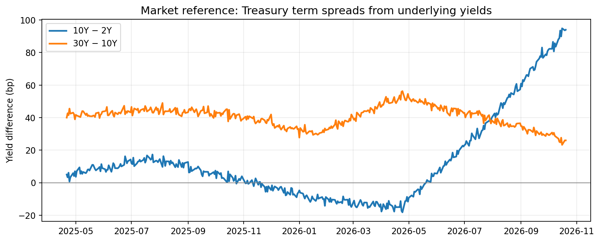
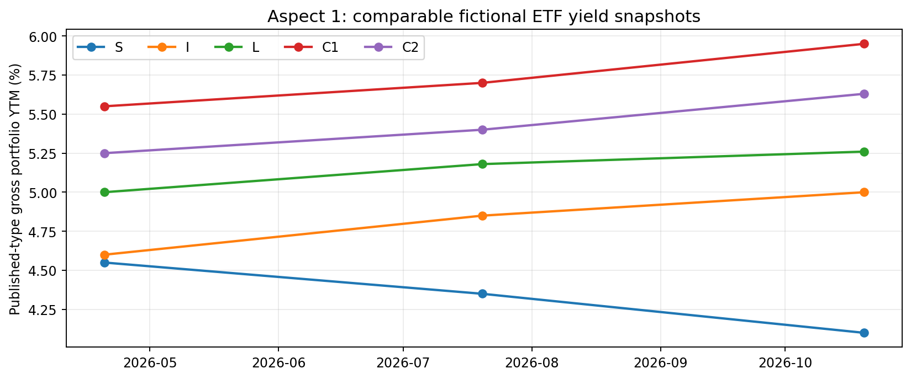
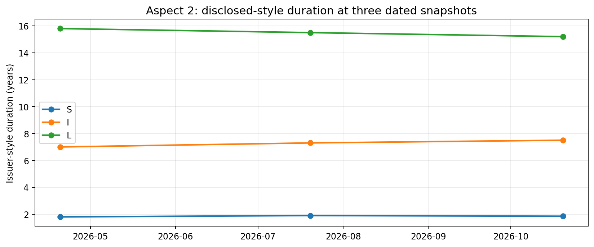
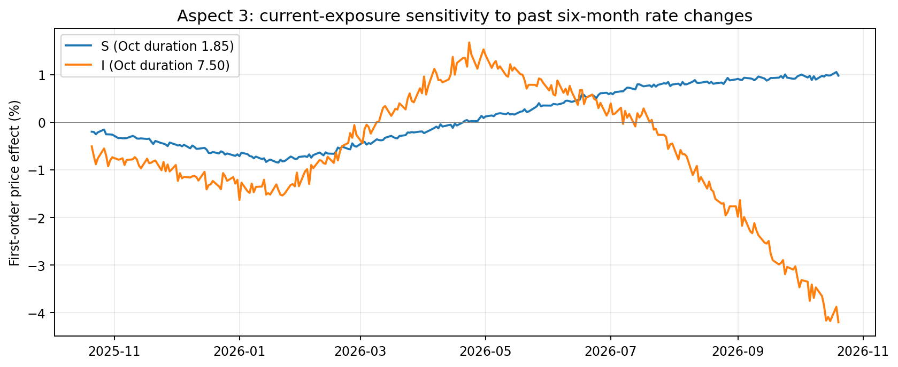
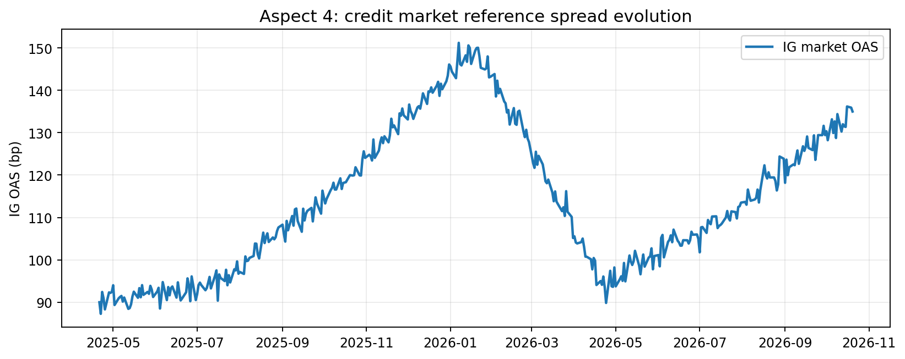

# Bondview-v3 — Aspect-Based Bond ETF Decision Examples

**Status: PROVISIONAL replacement companion, 2026-10-20.** This document illustrates the revised [`bond_etf_decision_architecture.md`](bond_etf_decision_architecture.md), especially §§5–9 and 13. It replaces the *design examples* from the earlier, break-even-centered companion, which remains reference-only. This is an economic interpretation and calculation specification for review, not an investment recommendation or authorization for implementation.

> **Source convention for the whole document.** Every market observation, ETF profile, issuer date, and numerical result below is **constructed**, not retrieved from FRED or a real ETF issuer. Named ETF examples `S`, `I`, `L`, `C1`, `C2`, and `H` are fictional. The attached CSV files reproduce these examples. In actual Bondview, use dated FRED factors and official issuer disclosures. Do not interpret the patterns below as genuine historical episodes.

## 1. Objective and example contract

**Goal:** show that economically recognized fixed-income measures can be calculated consistently, compared across **eligible ETFs** at one date, and examined **through time** where dated inputs are available. A measurement can be economically informative without producing a buy/sell verdict. No aspect-specific attractiveness score, mandatory cross-aspect formula, or composite score is required.

For each example, state the **question, measurement, unit, input source/type, cross-ETF comparison, time comparison, and qualification**. Distinguish **market context** from **ETF-specific results**. One aspect may contain several standard measures; its historical and cross-product presentations reuse the same calculation, not different evaluation engines.

The five provisional aspects are (1) yield/compensation, (2) rate sensitivity, (3) historical rate variability, (4) credit compensation/risk, and (5) currency exposure/hedging (conditional and lower priority). Product structure and input provenance determine eligibility, not attractiveness.

### 1.1 Canonical market inputs and derived fields

The market dataset covers **2025-04-21 to 2026-10-20** at business-day endpoints. The inputs are nominal U.S. Treasury reference yields at **2Y, 5Y, 10Y, 30Y** (percent) and one investment-grade market OAS reference (basis points). The 5Y factor is for the illustrative credit comparisons. The underlying series are stored **once** in [`assets/constructed_market_daily.csv`](assets/constructed_market_daily.csv).

For real observations, retrieve relevant underlying FRED Treasury factors such as `DGS2`, `DGS5`, `DGS10`, and `DGS30`, and calculate relationships in Bondview. Do **not** acquire precomputed `T10Y2Y` as a separate primary input. The market-level calculations reuse the same aligned tenor inputs:

\[
S_{10-2}(t)=100\,[y_{10}(t)-y_2(t)]\quad\text{bp},\qquad
S_{30-10}(t)=100\,[y_{30}(t)-y_{10}(t)]\quad\text{bp}
\]

Here the source yields are in **percentage units**; subtracting them and multiplying by 100 converts a percentage-point spread into basis points. In the duration formulas below, yield changes are converted to **decimal units** (`50 bp = 0.005`). Missing observations or misaligned dates do not justify inventing a value.

### 1.2 Issuer-style ETF inputs and disclosure dates

The illustrative universe deliberately contains both comparable and inapplicable products. The exposure characteristics are *dated issuer-style entries*, **not durations inferred from tenor labels**. The file [`assets/constructed_issuer_snapshots.csv`](assets/constructed_issuer_snapshots.csv) contains all three available dates: **2026-04-20**, **2026-07-20**, and **2026-10-20**. For the fixture only, assume the data became available at the corresponding assessment cutoffs. Never backfill earlier snapshots with the latest profile.

| Fictional ETF | Structure / market factor | Yield definition | Currency / hedge policy |
|---|---|---|---|
| **S** | Cash Treasury, short; 2Y reference | Gross **portfolio YTM** | USD exposure, no hedge |
| **I** | Cash Treasury, intermediate; 10Y reference | Same gross portfolio YTM convention | USD exposure, no hedge |
| **L** | Cash Treasury, long; 30Y reference | Same gross portfolio YTM convention | USD exposure, no hedge |
| **C1** | Investment-grade cash credit, 5Y Treasury + matched IG OAS reference | Same gross portfolio YTM convention | USD exposure, no hedge |
| **C2** | Investment-grade cash credit, same two reference factors but lower durations | Same gross portfolio YTM convention | USD exposure, no hedge |
| **H** | Cash Treasury, partially USD/KRW hedged; 10Y reference | **Unavailable** | Dated published hedge coverage |

The common gross portfolio YTM convention makes comparisons *of that measure* possible in this fixture. It does **not** make a gross USD YTM an ETF's realized holding-period carry or net KRW compensation. For credit `C1/C2`, the common IG OAS factor is a deliberately matched broad-market **proxy**, not an issuer-published ETF OAS.

## 2. Aspect 1 — Yield and compensation

**Economic question:** What yield compensation is visible in the Treasury market, and how do comparable reported yields differ across products and assessment dates?

### 2.1 Treasury term compensation: market reference

*Source: the constructed daily Treasury factors, all available observations. Both lines are derived—not separately downloaded—from underlying tenor yields.*

At the illustrative assessment dates:

| Market observation | 2026-04-20 | 2026-10-20 | Change |
|---|---:|---:|---:|
| 2Y reference yield | 4.65% | 4.12% | −53 bp |
| 10Y reference yield | 4.50% | 5.06% | +56 bp |
| 30Y reference yield | 5.02% | 5.32% | +30 bp |
| **10Y − 2Y** | **−15 bp** | **+94 bp** | **+109 bp** |
| **30Y − 10Y** | **+52 bp** | **+26 bp** | **−26 bp** |

**Interpretation:** The 10Y segment's yield advantage over 2Y increases markedly, while 30Y's additional yield over 10Y decreases. That is a statement about **market term spreads**—not bond price performance and not an ETF holding-period return. The changing 10Y−2Y spread reflects movements in *both* Treasury tenors; one must not assign it to a single cause without further evidence.

### 2.2 Cross-ETF yield measurement and its evolution

The same compatible published-yield definition is compared at each issuer snapshot; no bond-market reference yield is silently substituted for an ETF issuer value.

| ETF | Apr 20 YTM | Jul 20 YTM | Oct 20 YTM | April → October |
|---|---:|---:|---:|---:|
| S | 4.55% | 4.35% | **4.10%** | −45 bp |
| I | 4.60% | 4.85% | **5.00%** | +40 bp |
| L | 5.00% | 5.18% | **5.26%** | +26 bp |
| C1 | 5.55% | 5.70% | **5.95%** | +40 bp |
| C2 | 5.25% | 5.40% | **5.63%** | +38 bp |

At October 20, **I offers 90 bp more stated gross portfolio YTM than S** (`5.00%−4.10%`). The comparable *market reference* 10Y−2Y spread is **94 bp**; these are different quantities and need not agree. The higher credit ETF YTMs do not, by themselves, show that credit risk is adequately rewarded. ETF `H` remains `unavailable` for the yield comparison.

**Cross-ETF:** compare the **same yield definition** on the same date among suitable products. **Historical:** calculate that same measurement separately on each valid disclosure date. **Not calculated:** carry, roll-down, net hedged-KRW yield, or total holding-period return; issuer YTM alone does not establish those quantities.

## 3. Aspect 2 — Interest-rate sensitivity

**Economic question:** How sensitive is each eligible ETF exposure to an equal, explicitly declared rate move? Has its *reported exposure* changed over time?

For modified/effective duration `D` and matched yield change `Δy` in **decimal** units:

\[
\text{First-order price effect}\ \approx -D\,\Delta y.
\]

The calculation is conventional; it is not a projection of yields or a full ETF total return. For cross-product comparability, use a **common +50 bp scenario** in the appropriate matched interest-rate factor for each ETF (the scenario is not assumed to have occurred). Each duration is an explicitly dated issuer-style input. A duration may change only when the disclosed exposure changes; a fixed shock with a fixed duration produces a fixed result.

### 3.1 Selected-date comparison

| ETF | Oct 20 duration | Common +50 bp: approximate price effect |
|---|---:|---:|
| S | 1.85 | **−0.93%** |
| I | 7.50 | **−3.75%** |
| L | 15.20 | **−7.60%** |
| C1 (rates only) | 5.50 | −2.75% |
| C2 (rates only) | 3.90 | −1.95% |
| H (rates only) | 7.30 | −3.65% |

The difference between **I** and **S** under the matched +50 bp scenarios is approximately **−2.83 percentage points** of *rate-related price effect* (`−3.75 − (−0.925)`). This measures conditional rate sensitivity, **not expected ETF underperformance**. Credit ETFs also have credit-spread risk, treated separately in §5. The rate durations and factor matches are explicit; market tenor labels were not substituted for duration.

### 3.2 Exposure comparison through time

| ETF | Apr 20 duration | Jul 20 duration | Oct 20 duration |
|---|---:|---:|---:|
| S | 1.80 | 1.90 | **1.85** |
| I | 7.00 | 7.30 | **7.50** |
| L | 15.80 | 15.50 | **15.20** |

**Interpretation:** I's disclosed duration increases while L's decreases. Applying the **same +50 bp shock** to each dated duration would produce a correspondingly changing *conditional sensitivity*. There is no need to fabricate a daily ETF-duration history between disclosures, or plot an unchanging sensitivity when both duration and shock are fixed. Convexity and published key-rate durations may refine these estimates when genuinely available; they are not prerequisites for a useful first-order comparison.

## 4. Aspect 3 — Historical interest-rate variability

**Economic question:** What was the observed scale and evolution of *market rate changes* over a specified horizon, and what rate sensitivity would the selected **current ETF exposures** have had to changes of those sizes?

For every business-day endpoint `t` with a valid date six calendar months earlier, calculate **separately for each relevant tenor**:

\[
\Delta y_{n,6m}(t)=y_n(t)-y_n(t-6m).
\]

The start is the latest available input observation **on or before** the six-calendar-month-earlier date; neither future observations nor interpolated prices are introduced. Here the change horizon is **six months**, the daily endpoint sequence is the **sampling frequency**, and the available preceding market series is the **reference history**. These are different choices. Nearby windows overlap heavily; the plotted daily values are not independent market episodes.

For the October 20 snapshot, the paired market changes since April 20 are:

| Market factor | Six-month change |
|---|---:|
| 2Y yield | **−53 bp** |
| 10Y yield | **+56 bp** |

Using **October 20 disclosed durations** of S=1.85 and I=7.50, the first-order rate-only price effects of these historical-sized moves would be **+0.9805% (S)** and **−4.20% (I)**. This is a **current-exposure counterfactual**, not either ETF's realized April–October performance.

**How to read the chart:** A point above zero means the corresponding *rate move* would produce a positive first-order price effect for that current ETF exposure; below zero means negative. The lines display `−D_S(Oct) × Δy_2,6m(t)` and `−D_I(Oct) × Δy_10,6m(t)` in percent. They do **not** display ETF total returns, a relative-return-plus-compensation formula, or a generic attractiveness index. The paired rates can move differently, and no parallel-shock assumption is required.

**Across ETFs:** compare signed rate-price effects for the same endpoints/horizon, using each ETF's matched factor and declared exposure. **Through time:** inspect when those modeled effects increased or decreased. A spread/range or historical quantile may summarize the same series if useful; no threshold-frequency count or histogram is mandatory. A genuinely historical ETF exposure-based series would require suitable **point-in-time issuer disclosures** covering the dates; otherwise keep the current-exposure label. We do not infer future movement probabilities from the distribution.

**Reproducible source:** [`assets/constructed_6m_rate_variability.csv`](assets/constructed_6m_rate_variability.csv) contains the actual date pairs for this exercise and their yield changes and signed price effects; it is derived from `constructed_market_daily.csv`.

## 5. Aspect 4 — Credit compensation and spread risk

**Economic question:** How did the market's credit spread change independently of Treasury yields, and how does a matched spread move affect eligible credit ETFs with different disclosed spread durations?

The market OAS history is a *reference* rather than an ETF credit yield:

From April 20 to October 20, the constructed 5Y Treasury reference yield changes from **4.55% to 4.63%** (**+8 bp**), while matched investment-grade OAS changes from **95 to 135 bp** (**+40 bp**). Under the conventional spread-plus-reference-rate approximation, the change in a matched corporate yield would have a **+8 bp Treasury component** and a **+40 bp OAS component**. This is credit-market repricing, not evidence of realized defaults or a full credit ETF yield change.

For supported ETF exposures and a declared **+50 bp OAS widening**, holding the matched Treasury rate unchanged:

\[
\text{Spread-only price effect}\ \approx-D_{\mathrm{spread}}\Delta\mathrm{OAS}.
\]

| ETF | Apr 20 spread duration | Jul 20 | Oct 20 | October spread-only effect at +50 bp |
|---|---:|---:|---:|---:|
| C1 | 5.20 | 5.10 | **5.00** | **−2.50%** |
| C2 | 3.40 | 3.50 | **3.50** | **−1.75%** |
| S / I / L | N/A | N/A | N/A | **N/A** (pure Treasury) |

**Across ETFs:** at October 20, C1 has 0.75 percentage points more sensitivity to this common credit-spread shock than C2. **Through time:** the same spread-duration measure can be compared at the three valid issuer cutoffs; historical market OAS and rate components are monitored separately. The reference IG OAS is a *common market proxy* for C1/C2, not a reconstruction of either portfolio's credit holdings. Ineligible Treasury exposures remain `N/A`; unsupported issuer spread duration would be `unavailable`, not zero. C1/C2's greater gross YTM in §2 must not be automatically equated with adequate credit compensation.

## 6. Aspect 5 — Currency exposure and hedging (conditional)

**Economic question:** What published currency exposure or hedge policy distinguishes applicable ETFs, and how would an unhedged USD asset translate into KRW under a specified exchange-rate move?

For a fully unhedged USD return and consistently defined USD/KRW (KRW per USD) return, the standard identity is:

\[
1+R_{\mathrm{KRW}}=(1+R_{\mathrm{USD}})(1+R_{\mathrm{USDKRW}}).
\]

For example, a **−2% USD bond result** and **+8% USD/KRW** produce `(0.98 × 1.08 − 1) × 100 = +5.84%` in KRW. This is a *conditional translation example* applicable to an unhedged return; it is not a forecast or a net-return estimate for a hedged product.

At the issuer cutoffs, S/I/L/C1/C2 have **0% reported hedge coverage** in this fixture. H's disclosed nominal hedge coverage changes from **93% → 94% → 95%** at Apr/Jul/Oct; this numeric exposure attribute can be compared by date and across eligible products. It does **not** justify multiplying H's USD return by an inferred residual FX percentage to manufacture an actual hedged net KRW return. Hedge instruments, accounting, costs and policy effectiveness are not supplied; H's net-hedged compensation/sensitivity is therefore **unavailable**.

A currency aspect is viable when credible quantitative inputs exist; otherwise show a clear policy qualification and defer its numerical result. Do not add synthetic net hedge carry merely to fill the output matrix.

## 7. Cross-aspect comparison: one date, same ETF universe

This is a **measurement matrix**, not an additive score or a ranked ETF list. Values below use the **2026-10-20** issuer snapshots and the same declared scenarios. More yield, less sensitivity and less spread risk are distinct, not directly additive properties.

| ETF | Gross portfolio YTM | Duration | Rate-only +50 bp price effect | Credit OAS +50 bp effect | Hedge coverage |
|---|---:|---:|---:|---:|---:|
| **S** | 4.10% | 1.85 | −0.93% | N/A | 0% |
| **I** | 5.00% | 7.50 | −3.75% | N/A | 0% |
| **L** | 5.26% | 15.20 | −7.60% | N/A | 0% |
| **C1** | 5.95% | 5.50 rate duration | −2.75% | −2.50% | 0% |
| **C2** | 5.63% | 3.90 rate duration | −1.95% | −1.75% | 0% |
| **H** | unavailable | 7.30 | −3.65% | N/A | 95% |

**Interpretation example:** I has higher published gross YTM than S **and** greater rate sensitivity. C1 has higher published gross YTM than C2 **and** greater OAS sensitivity. These facts are meaningful separately; the table does not invent a weighted attractiveness ranking. H's yield is unavailable and its hedge coverage is a structural/exposure fact, not a costless guarantee of KRW stability.

**Temporal application:** §§2–6 show market series and the three available issuer assessments using the same measure definitions. Do not manufacture daily historical ETF profiles between disclosures; market-only daily observations and issuer-style snapshots have different evidentiary status.

## 8. Optional conditional calculation: break-even is not an aspect

A conventional compensation-versus-rate-move break-even can still answer a **specific what-if question**, provided holding-period compensation and rate exposure are defensible and of matching horizon/currency:

\[
\Delta y_{\mathrm{BE}}\approx\frac{c_{I,H}-c_{S,H}}{D_I-D_S}
\]

For a separate **assumed** holding-period scenario—not derived from the ETF YTMs above—suppose I has **2.40%** comparable six-month compensation and S has **1.90%**. With their October durations of 7.50 and 1.85, a **common, parallel yield increase of approximately 8.85 bp** would offset the additional 0.50 pp compensation in the first-order relative comparison. A historical break-even plot is not required by this isolated scenario, and the assumed 2.40%/1.90% inputs are *not* validated portfolio carry. This conditional arithmetic is optional; it does not determine the importance of the yield or duration aspects.

## 9. Hand-checkable calculations and verification rules

The examples should be independently reproducible from the companion CSV files. Recommended checks:

| Check | Expected output |
|---|---|
| October 10Y−2Y market spread | `(5.06−4.12)×100 = +94 bp` |
| April 10Y−2Y market spread | `(4.50−4.65)×100 = −15 bp` |
| October ETF I minus S published YTM | `5.00%−4.10% = +90 bp` — **not** the 94 bp market spread |
| ETF I +50 bp first-order price effect | `−7.50×0.005 = −3.75%` |
| ETF L +50 bp first-order price effect | `−15.20×0.005 = −7.60%` |
| October 2Y six-month yield change | `4.12%−4.65% = −53 bp` |
| October 10Y six-month yield change | `5.06%−4.50% = +56 bp` |
| ETF S current-exposure six-month rate effect | `−1.85×(−0.0053) = +0.9805%` |
| ETF I current-exposure six-month rate effect | `−7.50×0.0056 = −4.20%` |
| ETF C1 +50 bp OAS-only price effect | `−5.00×0.005 = −2.50%` |
| ETF C2 +50 bp OAS-only price effect | `−3.50×0.005 = −1.75%` |
| USD/KRW translation fixture | `(1−0.02)(1+0.08)−1 = +5.84%` |
| Optional I-versus-S parallel-shift break-even | `(0.024−0.019)/(7.50−1.85)×10,000 ≈ 8.85 bp` |

**Behavioral checks** (do not substitute invented values for failed cases): underlying FRED tenor inputs are canonical; term spreads are derived once with declared units and aligned dates; issuer yield definitions must match before comparison; ETF duration is not its benchmark tenor; constant duration under fixed shock gives constant sensitivity; a current-exposure application of historical market changes is clearly counterfactual; pure Treasury credit OAS is `N/A`; missing yield or issuer spread duration is `unavailable`; ordinary cash-bond carry is `unsupported` for futures by default; hedged KRW net return is unavailable without sufficient hedge economics; issuer values do not leak into earlier cutoffs; ETF price/NAV history is excluded from selection measures. Synthetic arithmetic tests establish formula correctness, **not trading performance**.

## 10. What this replaces, and what remains open

The earlier examples document is **not** inherited as a required chart suite or as a committed calculation sequence. In particular, the previous mandatory **duration-normalized break-even history**, paired-shock-threshold frequency and attempt to merge yield compensation and historical rate moves into a single result are not carried forward. Individual valid equations can remain optional when they answer a clear conditional question.

This replacement illustrates the agreed architecture using **canonical input reuse and measure-by-measure comparisons**. The next economic review should assess whether a proposed measure answers its stated question with compatible issuer inputs—not whether it can be turned into an attraction index. In actual research, select representative **real, officially documented ETFs** and real FRED histories; verify as-of dates, yield conventions, rate-factor matching, spread-duration availability, futures exclusions and whether limited currency/hedging information supports numerical comparison. A demonstration that some current products lack an eligible measure is a valid result.

### Companion artifacts

| File | Contents |
|---|---|
| [`assets/constructed_market_daily.csv`](assets/constructed_market_daily.csv) | Canonical 2Y/5Y/10Y/30Y yields, IG OAS and internally derived term spreads, every business-day endpoint |
| [`assets/constructed_issuer_snapshots.csv`](assets/constructed_issuer_snapshots.csv) | Issuer-style product types and three dated characteristics for fictional ETFs S/I/L/C1/C2/H |
| [`assets/constructed_6m_rate_variability.csv`](assets/constructed_6m_rate_variability.csv) | Matched six-month historical market-yield changes, and current-exposure counterfactual effects for S/I |
| [`assets/treasury_term_spreads.png`](assets/treasury_term_spreads.png) | Derived tenor-spread history; market context |
| [`assets/etf_yield_comparisons.png`](assets/etf_yield_comparisons.png) | ETF yield measure across products and valid issuer dates |
| [`assets/etf_duration_evolution.png`](assets/etf_duration_evolution.png) | Dated reported-style ETF durations |
| [`assets/etf_rate_variability_counterfactual.png`](assets/etf_rate_variability_counterfactual.png) | Fixed-current-duration price effects under past six-month matched market changes |
| [`assets/ig_oas_history.png`](assets/ig_oas_history.png) | Market IG OAS history, separated from ETF credit exposure |

**External source conventions for eventual nonconstructed inputs:** [FRED DGS2](https://fred.stlouisfed.org/series/DGS2), [DGS5](https://fred.stlouisfed.org/series/DGS5), [DGS10](https://fred.stlouisfed.org/series/DGS10), [DGS30](https://fred.stlouisfed.org/series/DGS30); matched ICE BofA/FRED investment-grade OAS; dated official issuer ETF fact sheets and published yield definitions. These links describe future source contracts, not sources of the constructed numbers in this document.
