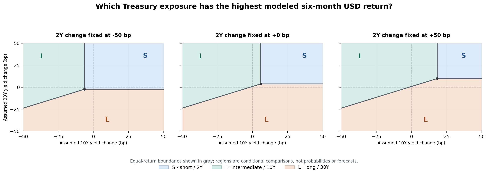

# Bondview-v3 — Fixed-Income Analysis Examples

**Status:** PROVISIONAL companion for design review — updated 2026-10-23 from the GitHub `analysis` branch. Analysis 1 presentation examples have been revised against [`bond_etf_decision_architecture.md`](bond_etf_decision_architecture.md); other analysis examples remain unchanged. This document does **not** authorize implementation or recommend an investment.

## 1. Purpose and conventions

This companion illustrates what investors could learn from **Analysis 1 (§3.1, Treasury Market Conditions and Scenarios)** and **Analysis 2 (§3.2, Holding-Period Return)** in one investment case. Analysis 1 leads with **presentation sketches**: two candidate primary market results, an optional conditional-scenario result, and an optional PCA supporting note. Detailed method selection and presentation design are deferred. The architecture remains the governing contract, and Analysis 2 does not require a prior Analysis 1 run.

**Constructed-data convention.** All dates, Treasury observations, exposure IDs, issuer-style profiles and numbers below are **illustrative**, not actual historical FRED data, real ETF disclosures, forecasts, or realized returns. Reproducible curve and Analysis 2 arithmetic use existing repository fixtures: [`constructed_market_daily.csv`](https://github.com/lbk209/bondview-v3/blob/analysis/docs/assets/constructed_market_daily.csv) and [`constructed_issuer_snapshots.csv`](https://github.com/lbk209/bondview-v3/blob/analysis/docs/assets/constructed_issuer_snapshots.csv). **Analysis 1 presentation-only mock-ups** for term-premium decomposition, conditional scenarios and PCA are explicitly labeled; their values are not derived from these fixtures, sourced estimates or an underlying synthetic dataset.

**Reading conventions.** Each example leads with what an investor would see, followed by interpretation, inputs/assumptions, and verification. Yield changes and curve spreads are in **basis points (bp)**; modeled returns are percentages and differences between returns are in **percentage points (pp)**. A rate-change assumption is neither a forecast nor a probability estimate. ETF profiles are distinguished from reference Treasury tenors; no modeled USD gross bond-exposure return is presented as the net KRW outcome of a Korean-listed ETF. All modeled cash-bond exposures are assumed eligible under the architecture's data and factor-compatibility rules.

## 2. One investment case: evaluating Treasury duration

**Investor's question.** “Long-term U.S. Treasury yields have risen. If they rise only modestly from here—or decline—what evidence should I examine, and what conditions would favor short-, intermediate-, or long-duration Treasury exposure?” The market view is the **investor's hypothesis**; no analysis below establishes it as likely.

**Assessment date:** 2026-10-20. **Reference market period:** 2026-04-20 → 2026-10-20. **Conditional investment horizon for Analysis 2:** 183 calendar days (`H = 183/365 = 0.501369863` under ACT/365 Fixed), chosen for illustration, **not** inferred as the likely future path from the prior six months.

### 2.1 Analysis 1 — Treasury Market Conditions and Scenarios (§3.1)

**Purpose.** Help investors interpret maturity-specific Treasury market conditions, distinguish expected-rate and term-premium explanations when supported, and supply coherent yield-curve scenarios to Analysis 2 when useful. The examples below are **display concepts**, not a requirement to publish a separate result for every model.

#### A. Candidate primary user-facing results

##### A1. Treasury curve regime — where has rate pressure concentrated?

> **2Y–10Y steepening, 10Y–30Y flattening.** From April to October, the 2Y yield **fell 53 bp**, while the 10Y **rose 56 bp** and the 30Y **rose 30 bp**. This is a mixed curve twist, not a uniform bull or bear shift.

| Tenor | Yield at start | Yield at end | Change | Immediate interpretation |
|---|---:|---:|---:|---|
| **2Y** | 4.65% | 4.12% | **−53 bp** | Falling short-end yields supported short-tenor *rate-price* returns |
| **10Y** | 4.50% | 5.06% | **+56 bp** | Greatest upward yield movement among these tenors |
| **30Y** | 5.02% | 5.32% | **+30 bp** | Smaller yield rise than 10Y, but greater duration may still magnify the price effect |

**Tenor-selection insight:** The recent rate move was more favorable to the short end than to the 10Y on a rate-price basis. This **describes the past**, rather than favoring a specific ETF for the next holding period. The current compensation and the investor's forward-looking rate view remain relevant.

##### A2. Long-yield decomposition — expected rates or term compensation?

> **Illustrative model interpretation:** Most of an example increase in the 10Y **model-fitted yield** comes from the term-premium component, rather than revised expectations of future short rates.

| Model-implied change over an illustrative interval | Contribution |
|---|---:|
| 10Y fitted zero-coupon yield | **+60 bp** |
| Expected average future short-rate component | +15 bp |
| Term-premium component | **+45 bp** |

**Tenor-selection insight:** Increased term compensation may help explain why long-maturity yields remained under upward pressure even without comparably large changes in expected policy rates. Long-duration ETF exposure could remain sensitive to premium changes independently of the near-term Fed policy path. The model does **not** identify a cause such as fiscal issuance or inflation uncertainty without separate evidence, nor does a larger premium imply an imminent decline.

*Presentation-only mock-up. These +60/+15/+45 bp figures are invented to illustrate the display, **not** an ACM, CR or KW estimate, not measured from the constructed market CSV, and not an attribution of the April–October curve changes above. A real result would use one internally consistent published model.*

#### B. Optional supporting user-facing result — conditional joint movements

##### B1. What follows for 2Y and 30Y if the investor expects a moderate 10Y increase?

**Investor's condition (input, not result):** 10Y yield increases **25–50 bp** over the next six months.

| Example joint curve outcome | Δ2Y | Δ10Y (conditioned) | Δ30Y | Curve interpretation |
|---|---:|---:|---:|---|
| Short end rises fastest | +65 bp | +35 bp | +15 bp | Bear flattening |
| Broad rise | +30 bp | +40 bp | +45 bp | Approximately parallel |
| Long end rises fastest | +5 bp | +40 bp | +75 bp | Bear steepening |

**Finding the model should actually deliver:** How **other tenors move jointly** when the stated 10Y condition holds—including their variation and whether relative curve configurations differ. These examples illustrate why a view about one yield does not determine relative ETF outcomes.

**Use:** Supply the *complete, coherent vectors* to Analysis 2 for matched ETF return comparisons. A standalone scenario table is optional if it adds no investment insight beyond Analysis 2.

*Presentation-only hypothetical vectors, **not** observed historical intervals, estimated conditional quantiles or assigned probabilities. Actual historical conditioning must retain same-interval 2Y/10Y/30Y moves; a model-based method must preserve justified cross-factor relationships.*

##### B2. PCA factor structure — optional explanatory note, not a required result

| Historical factor interpretation | Illustrative explained variance |
|---|---:|
| Broad common movement (level-like) | 75% |
| Relative short/long movement (slope-like) | 20% |
| Intermediate-versus-end movement (curvature-like) | 5% |

**Tenor-selection insight:** A large common factor suggests substantial shared interest-rate exposure across tenors, while slope and curvature differences can still matter for ETF comparisons. The factor analysis is **supporting evidence**, not a preferred-tenor result; if used for Analysis 2 scenarios, PCA requires an additional conditioning/construction method.

*Illustrative PCA percentages, not calculated loadings. Explained variance is **not** the fraction of dates on which all tenors moved in the same direction. Factor labels would require checking actual loadings.*

#### C. Supporting observations and deferred design notes

The A1 curve observations above are drawn from the constructed `DGS2_pct`, `DGS10_pct` and `DGS30_pct` rows for **2026-04-20 → 2026-10-20** in [`constructed_market_daily.csv`](https://github.com/lbk209/bondview-v3/blob/analysis/docs/assets/constructed_market_daily.csv). The intermediate 2026-07-20 observations remain available in that fixture. Spreads should be recalculated from aligned yields, not treated as independent inputs.

| Constructed spread | At start | At end | Change |
|---|---:|---:|---:|
| 10Y − 2Y | −15 bp | +94 bp | **+109 bp** |
| 30Y − 10Y | +52 bp | +26 bp | **−26 bp** |

The April–October changes form one **observed-in-the-constructed-dataset** joint vector `(−53, +56, +30) bp`; they are **not** a projection for the next six months. The decomposed yield in A2 must use matching fitted-model components, not be forced to equal `DGS10`. The scenario vectors in B1 are unrelated hypothetical presentation examples, not selected observations from the fixture. Any carry/roll refinement of a holding-return baseline belongs within **Analysis 2** when justified; it is not a separate Analysis 1 result.

The usefulness of published decomposition estimates, choice of historical conditioning versus regression/PCA, sample/regime sensitivity and whether optional outputs deserve screen space remain for later discussion. No model is mandatory merely because its format appears here.

### 2.2 Analysis 2 — Holding-Period Return (§3.2)

**Financial question.** Under what combinations of Treasury yield changes would the eligible S, I and L exposures have higher modeled returns over the chosen six-month horizon? How much does the answer depend on the other tenors, even if the investor has a view about one long rate?

#### A. User-facing result — conditional ETF preference regions

**Assessment:** 2026-10-20 issuer-style ETF profiles; **horizon:** `H = 183/365` years. **Quantity:** approximate **gross USD cash-Treasury exposure holding-period return**, before fees, transaction costs, taxes, and KRW FX/hedging. No forward path or probability is predicted.



**How to read the chart:** The horizontal axis is the **assumed 10Y yield change** and the vertical axis the **assumed 30Y yield change**, both in bp over the chosen horizon. Each panel fixes the **2Y yield change** at −50, 0, or +50 bp. A region identifies **which exposure has the largest modeled return**, conditional on the displayed three-tenor movements. Thin boundaries are equal-return conditions. No color represents a forecast probability, an ETF recommendation, or risk-adjusted attractiveness.

**A few points to read from the regions** (illustrations of the formula, **not** selected plausible forecasts):

| Fixed 2Y | Assumed 10Y | Assumed 30Y | S return | I return | L return | Highest modeled return |
|---:|---:|---:|---:|---:|---:|---|
| 0 bp | 0 bp | 0 bp | +2.06% | +2.51% | +2.64% | **L** |
| 0 bp | 0 bp | +30 bp | +2.06% | +2.51% | −1.92% | **I** |
| 0 bp | +30 bp | +30 bp | +2.06% | +0.26% | −1.92% | **S** |
| −50 bp | 0 bp | 0 bp | +2.98% | +2.51% | +2.64% | **S** |

The crucial finding is not which ETF wins at a chosen point: **the market view about one tenor does not by itself determine the relative outcome among different-duration ETFs.** The chart exposes the missing joint-rate assumptions rather than disguising them in a few hand-selected scenarios.

#### B. Financial interpretation

At unchanged factor yields and under this **first-order constant-yield compensation reference**, L's higher YTM produces the highest modeled USD return. But its much greater duration makes its result more sensitive to an increase in the 30Y yield. If 30Y rises materially while 10Y stays flat, I can outperform L; if both long tenors rise enough, S may outperform both. Even if the 30Y does not rise, a sufficiently large **decline** in 2Y yields can make S superior to L. This is not evidence that any of those joint combinations will happen.

**Connection to Analysis 1:** The observed divergence of 2Y and longer yields explains why the investor must consider different curve configurations, not merely “rates rise/fall.” Analysis 1 can investigate market information that bears on the plausibility of configurations, but its yield spreads and term-premium decomposition **cannot uniquely supply the yield-change vector**. Analysis 2's regions are therefore conditional comparisons, not conclusions inferred from Analysis 1.

The chart deliberately considers a broad rectangular shock range (−50 to +50 bp on the 10Y and 30Y axes) to **show where comparative outcomes switch**. This range is an illustrative *display domain*, not an estimated plausible interval, confidence region, or assumption that its points are equally likely. Risk, likelihood, and downside questions need separately justified evidence, potentially in Analysis 3.

#### C. Construction: exposure data and modeling choices

All three exposures use the **2026-10-20 issuer-style ETF profile** from [`constructed_issuer_snapshots.csv`](https://github.com/lbk209/bondview-v3/blob/analysis/docs/assets/constructed_issuer_snapshots.csv); none is a user-substituted benchmark. They are illustrative **USD cash Treasury exposures**.

| Exposure | Matched Treasury factor | Gross portfolio YTM | Effective/modified duration used | First-order compensation `YTM × 183/365` |
|---|---|---:|---:|---:|
| **S — short** | 2Y | 4.10% | 1.85 | +2.055616% |
| **I — intermediate** | 10Y | 5.00% | 7.50 | +2.506849% |
| **L — long** | 30Y | 5.26% | 15.20 | +2.637205% |

The published-style profiles are assumed to have the same compatible **gross portfolio YTM** definition and durations appropriate for the indicated *single-tenor-factor* first-order calculation. Real ETFs may have multiple key-rate exposures. Duration is measured at the **October 20 assessment date**, which is the *initial exposure* being stressed, not the ending duration of a realized April–October investment. All profiles are held fixed for the conditional exercise.

**Calculation choice:** `modeled gross USD return ≈ YTM × H − D × Δy` with `Δy` in decimal units. This is a **recognized first-order professional holding-period-return approximation**, not a Bondview-specific attractiveness score. It does not measure coupon cash received or separate roll-down. No unsupported convexity, spread or hedge terms are invented; convexity was not supplied in the fixture. Yield movements are treated as finite static-exposure shocks, not an explicit sequence of ETF rebalancings or a full cash-flow revaluation. Larger shocks and evolving ETF holdings can reduce approximation accuracy. The display does not infer net Korean-listed ETF performance.

For every chart point, the three factor changes collectively form a **hypothetical joint vector** `(Δ2Y, Δ10Y, Δ30Y)`; unlike Analysis 1's April–October vector, these are **user-inspectable assumptions**, not observed historical intervals. The horizon is chosen independently and shared by the three profiles. No hypothetical shock is derived by replaying the prior six months or automatically generated from 3C.

#### D. Calculations, equal-return boundaries, and verification

Use return units in **percentage points** and yield shocks in **basis points**. With `B_S = 2.055616`, `B_I = 2.506849`, and `B_L = 2.637205` in percentage-point units:

```text
R_S (%) ≈ B_S − 0.0185 × Δ2Y_bp
R_I (%) ≈ B_I − 0.0750 × Δ10Y_bp
R_L (%) ≈ B_L − 0.1520 × Δ30Y_bp
```

These coefficients are the respective durations divided by 100 because a 1 bp yield change is `0.0001` in decimal units and a return percent equals 100 times its decimal fraction.

The **equal-return boundaries** are obtained directly from the same Analysis 2 return approximations, not a distinct decision model:

```text
I = S :  Δ10Y_bp = (B_I − B_S + 0.0185 × Δ2Y_bp) / 0.0750
L = S :  Δ30Y_bp = (B_L − B_S + 0.0185 × Δ2Y_bp) / 0.1520
L = I :  Δ30Y_bp = (B_L − B_I + 0.0750 × Δ10Y_bp) / 0.1520
```

For `Δ2Y = 0`, the I=S threshold is `Δ10Y ≈ +6.02 bp`; L=S is `Δ30Y ≈ +3.83 bp`. If `Δ10Y = 0`, the L=I boundary is `Δ30Y ≈ +0.86 bp`. These are **pairwise** equal-return conditions. Only the boundary portions separating the *highest-return regions* are emphasized in the figure. The three boundaries intersect at approximately `(Δ10Y, Δ30Y) = (+6.02, +3.83) bp` when `Δ2Y = 0`. The boundaries shift when the assumed 2Y change shifts; they do not tell us which region is likely.

**Verification examples:**

- At `(Δ2Y, Δ10Y, Δ30Y) = (0,0,0)` bp, `(S,I,L) = (+2.055616,+2.506849,+2.637205)%`, so L is highest.
- At `(0,0,+30)` bp, L becomes `2.637205 − 0.152 × 30 = −1.922795%`; I remains `+2.506849%`, so I is highest.
- At `(0,+30,+30)` bp, I becomes `2.506849 − 0.075 × 30 = +0.256849%`; S remains `+2.055616%`, so S is highest.
- At `(−50,0,0)` bp, S becomes `2.055616 + 0.0185 × 50 = +2.980616%`, exceeding both I and L.

**Separate historical-stress arithmetic, retained from the prior example:** If the *observed* April 20–October 20 vector `(−53,+56,+30)` bp is applied **as a historical stress**, not the next-six-month expected path, the model gives S `+3.036116%`, I `−1.693151%`, L `−1.922795%`; S−I is `+4.729267 pp`, S−L is `+4.958911 pp`, and I−L is `+0.229644 pp`. These are current-exposure counterfactual returns and **not** the realized ETF returns during those dates. This stress is supplementary; it is not the main scenario or preference map.

**Validation rules:** Reconcile the chart classification against the largest of the three numeric modeled returns at each plotted point; verify return/bp conversions, common horizon, issuer source and as-of date, correct tenor mapping, and pairwise equality. Do not present the preference-region colors as calibrated event frequencies, probabilities, total risks, or buy/sell signals. A valid rate-only price effect without an eligible baseline must be labeled a **partial** result, not a complete return. ETF or benchmark realized total-return series must never be substituted for the compensation baseline.

### 2.3 Other analyses (examples pending review)

- **Analysis 3 — Risk and Stress (§3.3):** to be developed after review of the shared investment case and its conditional outcomes.
- **Analysis 4 — Credit Spread (§3.4):** to be developed after review.
- **Analysis 5 — Currency and Hedging (§3.5):** to be developed after review.

The present document is an **example-led design probe**, especially for Analysis 1. Its candidate outputs and open review questions do **not** silently amend the architecture or make any optional term-premium, regression, PCA, or visualization method mandatory. The earlier Aspect presentation and cross-Aspect scorecard are not restored.
