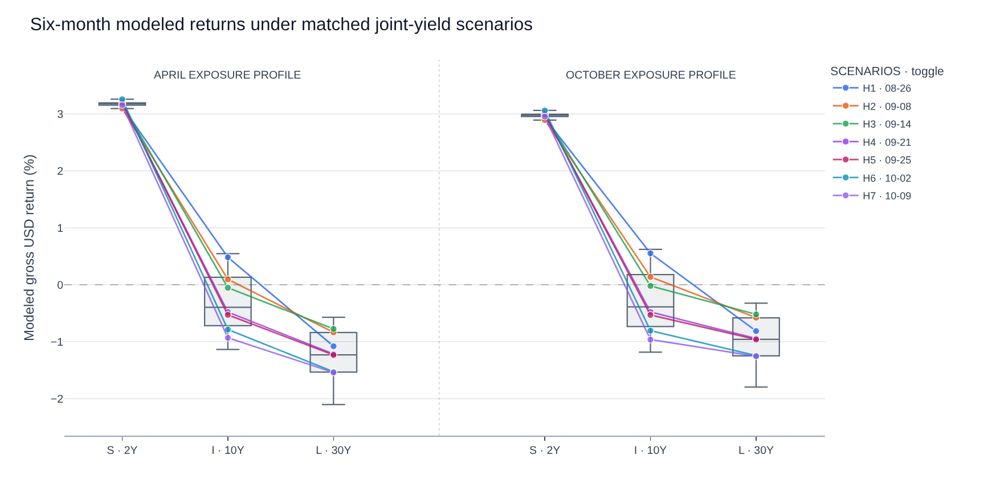
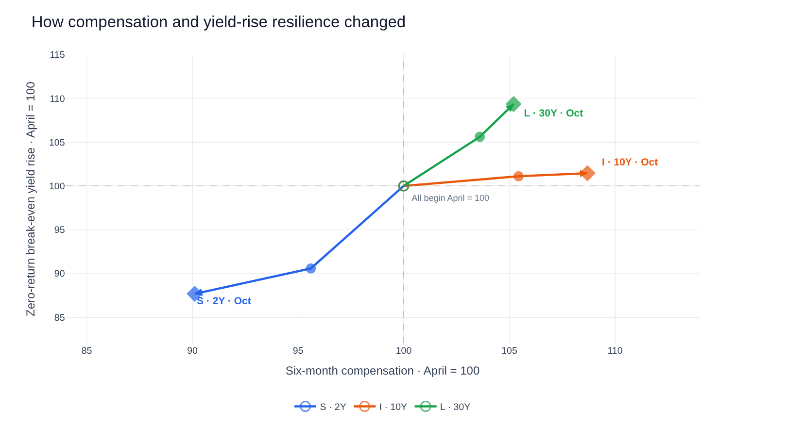

# Bondview-v3 — Fixed-Income Analysis Examples

**Status:** PROVISIONAL companion for design review, based on the GitHub `analysis` branch (2026-10-25). Analyses 1 and 2 have developed examples; Analyses 3–5 remain to be developed. The examples illustrate candidate investor-facing results, not implementation requirements or investment recommendations.

## 1. Purpose and reading conventions

This document demonstrates how fixed-income analysis could help an investor interpret U.S. Treasury conditions and compare eligible bond exposures. Each analysis introduces its own question and any additional inputs. An analysis may use results from an earlier one, but the examples are not a mandatory processing sequence or a single investment case that already covers all five analyses. The methods and eligibility rules are defined in [`bond_etf_decision_architecture.md`](bond_etf_decision_architecture.md); they are not restated here.

**Illustrative data and results.** The examples demonstrate analytical methods, financial interpretations, and potential investment applications. They may use historical observations, constructed datasets, or simplified assumptions, and do not necessarily represent a single historical episode. Numerical results should be understood as illustrations of the analyses rather than independent evidence supporting an investment decision.

**Interpretation and units.** Historical changes describe an interval; scenario assumptions define *conditional* outcomes rather than predicted market paths or probabilities. Treasury-market measures, modeled gross USD cash-bond returns, and realized net KRW ETF returns are distinct quantities. Yield/spread changes and yield-rise cushions are in basis points (bp); modeled returns are percentages of initial value and return differences are percentage points (pp). Individual examples state additional qualifications only where they affect the meaning of a result.

## 2. Analysis examples

### 2.1 Analysis 1 — Treasury Market Conditions and Scenarios (§3.1)

**Investor's question.** Where has interest-rate pressure concentrated across Treasury maturities, what might account for long-yield changes, and what joint yield movements are compatible with a partial market view?

#### A. Primary Treasury-market results

##### A1. Treasury curve conditions and movements — where has rate pressure concentrated?

| Treasury measure | 2024-09-16 | 2025-01-13 | Change | Curve configuration | Movement / regime |
|---|---:|---:|---:|---|---|
| 2Y yield | 3.56% | 4.40% | **+84 bp** | — | Yield rose |
| 10Y yield | 3.63% | 4.79% | **+116 bp** | — | Yield rose |
| 30Y yield | 3.94% | 4.97% | **+103 bp** | — | Yield rose |
| **10Y − 2Y spread** | **+7 bp** | **+39 bp** | **+32 bp** | Upward-sloping → upward-sloping | **Bear steepening** |
| **30Y − 10Y spread** | **+31 bp** | **+18 bp** | **−13 bp** | Upward-sloping → upward-sloping | **Bear flattening** |

**What the investor learns.** Treasury yields rose across all three maturities, but the 10Y yield increased the most. The **10Y − 2Y spread** widened as the 10Y yield rose faster than the 2Y yield, producing bear steepening. Meanwhile, the **30Y − 10Y spread** narrowed as the 10Y yield rose faster than the 30Y yield, producing bear flattening. This identifies the 10Y tenor as the point of greatest upward yield pressure among the three observations and motivates further investigation of expected-rate and term-premium changes.

**Observation-date selection.** The starting and ending dates determine the net movement reported in the table and therefore require careful selection. One approach is to examine the 10Y yield history, identify a period with a recognizable upward or downward direction, and select endpoints representing that movement. Here, the dates illustrate a substantial rise in the 10Y yield from its September 2024 low to January 2025. The resulting classifications describe the **net changes between the selected dates**, not every movement along the intervening path. The 10Y direction motivates the date selection; the relative movements of other tenors provide additional curve information.

**Data source.** U.S. Treasury Daily Treasury Par Yield Curve Rates:
- [September 2024](https://home.treasury.gov/resource-center/data-chart-center/interest-rates/TextView?field_tdr_date_value=2024&type=daily_treasury_yield_curve)
- [January 2025](https://home.treasury.gov/resource-center/data-chart-center/interest-rates/TextView?field_tdr_date_value_month=202501&type=daily_treasury_yield_curve)

Spreads are calculated from the corresponding tenor yields at each date. The classifications apply separately to the 2Y–10Y and 10Y–30Y curve segments. Yield movements indicate the direction of rate-price effects, while their magnitudes for ETF exposures depend on duration and other characteristics examined in Analysis 2.

##### A2. Long-yield decomposition — expected rates or term compensation?

**Illustrative model-component changes over a separate interval:**

| 10Y model component | Change |
|---|---:|
| Model-fitted zero-coupon yield | **+60 bp** |
| Expected average future short-rate component | +15 bp |
| Term-premium component | **+45 bp** |

**What the investor learns.** In this example, the term-premium component accounts for three-quarters of the modeled increase in the 10Y yield. This directs attention to changes in long-horizon risk compensation, rather than interpreting the whole yield rise as a change in expected monetary policy. A next investigation might consider inflation uncertainty, Treasury supply or investor demand, while using additional evidence before attributing the premium movement to any particular cause.

#### B. Optional scenario and factor results

##### B1. What happens at other maturities if the investor expects a moderate 10Y increase?

**Investor-specified condition:** 10Y yield rises **25–50 bp** over six months. The rows below illustrate possible *complete* joint yield-change vectors under that assumption.

| Illustrative curve outcome | Δ2Y | Δ10Y | Δ30Y | Curve interpretation |
|---|---:|---:|---:|---|
| Short end rises fastest | +65 bp | +35 bp | +15 bp | Bear flattening |
| Broad rise | +30 bp | +40 bp | +45 bp | Approximately parallel increase |
| Long end rises fastest | +5 bp | +40 bp | +75 bp | Bear steepening |

**What the investor learns.** The same partial view on 10Y yields can coexist with very different changes elsewhere on the curve. A historical-conditioning or supported statistical analysis could replace these presentation vectors with **dated, coherent joint scenarios** and show the range of accompanying movements. Those scenarios can then be used for paired ETF-return comparisons in Analysis 2; the three illustrative rows above are not the scenario sample used in Analysis 2.

##### B2. PCA factor structure — optional supporting interpretation

| Illustrative historical factor | Explained variance |
|---|---:|
| Common movement (level-like) | 75% |
| Short-versus-long movement (slope-like) | 20% |
| Intermediate-versus-end movement (curvature-like) | 5% |

**What the investor learns.** A dominant common factor would suggest substantial shared rate exposure across maturities, while slope and curvature variation could still matter for tenor selection. Factor loadings would establish the appropriate economic labels; the explained-variance shares alone do not supply joint scenarios or describe how often tenors move together.

### 2.2 Analysis 2 — Holding-Period Return (§3.2)

**Investor's question.** If 10Y Treasury yields rise moderately over the next six months, how do the modeled returns of short-, intermediate- and long-duration exposures compare under the *same* yield movements? Separately, how has the compensation available for each exposure changed over time?

**Additional inputs.** The assessment date is **2026-10-20**; the modeled holding horizon is **183 calendar days**, or `183/365 = 0.501369863` years (ACT/365 Fixed). Three synthetic cash-Treasury ETF-like profiles are compared: short (S, 2Y-like), intermediate (I, 10Y-like) and long (L, 30Y-like). Analysis 2 uses fixture-derived joint scenarios conditioned on a **+25 to +50 bp 10Y change**, rather than the illustrative rows in B1.

#### A. User-facing result — matched-scenario returns

[**Interactive Plotly chart — toggle scenarios H1–H7 in the legend**](assets/analysis2_matched_scenario_returns.html)

**What the investor learns.** S produces the highest modeled return in **all 28 selected joint-yield windows**, using either the April or October exposure profile. With the October profile, the modeled median return is approximately **+2.99% for S**, **−0.39% for I** and **−0.96% for L**. The result quantifies how a specific curve-movement pattern—falling 2Y yields and rising 10Y/30Y yields—affects differently positioned exposures.

Comparing the April and October panels under the **same scenario vectors** isolates the effect of changed YTM and duration profiles: S's modeled outcomes decline modestly, I's central result remains similar, and L's becomes less negative. This is a comparison of dated exposure profiles under a common set of movements, not a realized return between April and October.

**Reading the plot.** Each grey box summarizes the 28 return outcomes for one exposure/profile date (median, quartiles and range). Seven colored lines highlight individual matched windows: a given scenario ID uses the same complete yield vector across S, I, L and both panels. The linked interactive chart allows those highlighted scenarios to be shown or hidden.

#### B. Supporting result — compensation and yield-rise resilience across dates

[Interactive version — inspect each date's absolute compensation, break-even rise, YTM and duration](assets/analysis2_compensation_break_even_indexed.html)

**What the investor learns.** All three trajectories start at `(100, 100)` in April. Moving right means **greater six-month yield-based compensation** relative to the same exposure's April value; moving up means a **larger zero-return break-even rise in its own matched yield**. By October, S has declined on both dimensions; I offers greater compensation with nearly unchanged break-even resilience; L has improved on both. The paired changes make it easier to judge whether additional compensation is keeping pace with each exposure's rate sensitivity.

Absolute levels remain available alongside the indexed display:

| Exposure | April compensation | October compensation | April break-even rise | October break-even rise |
|---|---:|---:|---:|---:|
| **S — 2Y** | +2.28% | +2.06% | +126.7 bp | +111.1 bp |
| **I — 10Y** | +2.31% | +2.51% | +32.9 bp | +33.4 bp |
| **L — 30Y** | +2.51% | +2.64% | +15.9 bp | +17.4 bp |

The break-even rise is the yield increase that offsets **one exposure's** modeled compensation; it is not the yield movement at which two ETFs have equal returns. Its absolute value depends strongly on duration, so the indexed chart emphasizes **within-tenor changes** while retaining the absolute cushions for context.

#### C. Inputs, calculations and reproduction

**Exposure profiles.** The constructed issuer-style snapshots supply gross portfolio YTM, duration and reference tenor:

| Assessment date | S: YTM / duration | I: YTM / duration | L: YTM / duration |
|---|---:|---:|---:|
| 2026-04-20 | 4.55% / 1.80 | 4.60% / 7.00 | 5.00% / 15.80 |
| 2026-07-20 | 4.35% / 1.90 | 4.85% / 7.30 | 5.18% / 15.50 |
| 2026-10-20 | 4.10% / 1.85 | 5.00% / 7.50 | 5.26% / 15.20 |

**Return calculation.** For each profile, estimate six-month compensation from its portfolio YTM × `183/365`, and the rate-price effect from the matched tenor yield change and duration. The constructed exposure data do not supply additional convexity or roll-down terms, so the displayed outcomes use the first-order compensation-plus-duration approximation. This produces **modeled gross USD cash-bond exposure returns**, not actual ETF holding-period returns.

**Scenario selection and paired returns.** For each eligible ending date through **2026-10-20**, match the closest available starting observation to the date **six calendar months earlier**, allowing a ±7-day tolerance. From the constructed market dataset, retain complete DGS2/DGS10/DGS30 vectors where the 10Y yield increased **25–50 bp**: **28** windows qualify. Preserve the actual start/end dates and their observed-together changes; apply each complete vector to S, I and L under both April and October profiles. Seven chronologically spaced windows are highlighted as **H1–H7**; their endpoints and changes are in the [scenario data](assets/analysis2_conditioned_joint_windows.csv). The six-month historical windows are matched by calendar date, while the modeled compensation horizon uses the stated `183/365` year fraction.

These windows substantially overlap and all selected windows end after the April assessment date. Accordingly, the April panel is a **retrospective application** of scenarios also used at October, not an April-as-of backtest. Scenario counts describe the selected constructed sample, not estimated future probabilities.

**Compensation and break-even comparison.** For April, July and October, derive each exposure's zero-return break-even yield rise from the *same* compensation and duration assumptions. Index compensation and break-even **separately for each exposure** to 100 at April, connecting the three dated snapshots. The table and interactive hover information retain unindexed compensation, break-even, YTM and duration.

### 2.3 Analyses awaiting examples

- **Analysis 3 — Risk and Stress (§3.3):** assess adverse sensitivity and downside drivers, reusing the relevant return scenarios when helpful.
- **Analysis 4 — Credit Spread (§3.4):** introduce a credit-exposed case and examine rate-versus-spread effects.
- **Analysis 5 — Currency and Hedging (§3.5):** examine how currency and hedging terms change the outcome for a KRW investor.

Each future example should begin with its own investment question and necessary assumptions. It may extend an earlier example when that relationship adds insight; it need not inherit the current Treasury-only case.
